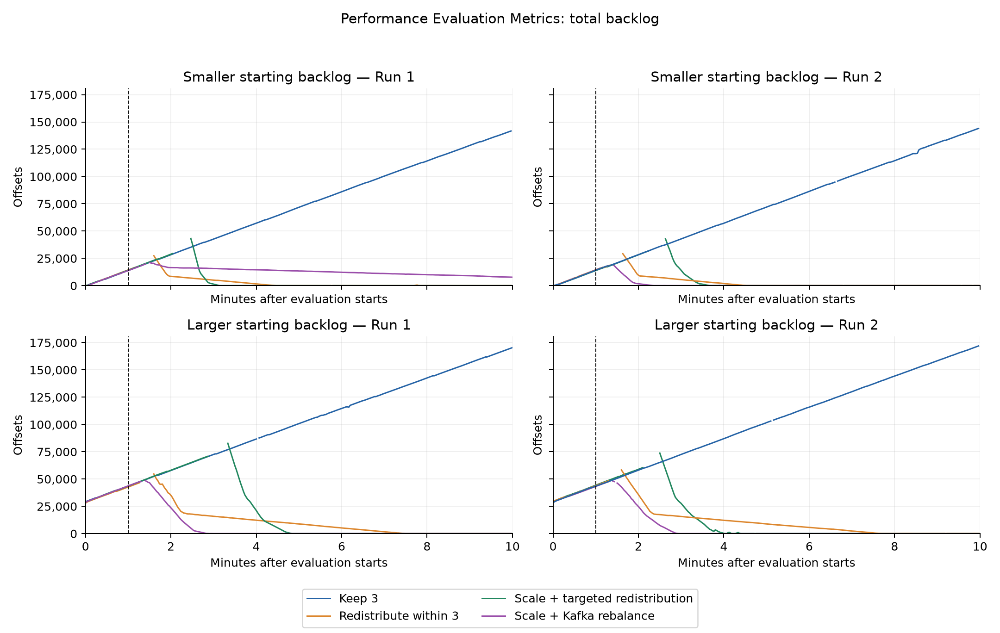
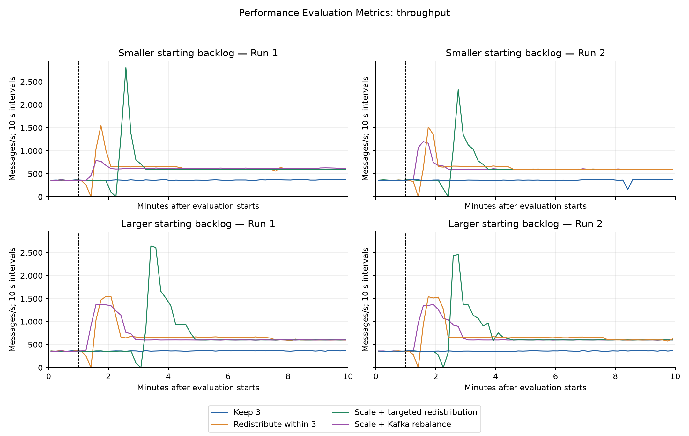

# Starting backlog and mitigation outcomes

Status: complete. Completed trials: 16 of 16.

Every evaluation uses 600 total messages/s, with 80% sent to twelve of sixty partitions. Different warm-up rates establish two backlog conditions. These histories also change the age of queued records; they are not a pure manipulation of queue size.

| Starting backlog | Response | Run | Completion p99 (s) | Unfinished (%) | Recovery confirmed (s) | Requested CPU (core-min) |
| --- | --- | ---: | ---: | ---: | ---: | ---: |
| Larger | Keep 3 | 1 | 394.372 | 38.49 | Unconfirmed | 72.0 |
| Larger | Keep 3 | 2 | 392.254 | 39.24 | Unconfirmed | 72.0 |
| Larger | Redistribute within 3 | 1 | 110.500 | 0.00 | 420.0 | 72.0 |
| Larger | Redistribute within 3 | 2 | 105.779 | 0.00 | 432.0 | 72.0 |
| Larger | Scale + targeted redistribution | 1 | 164.675 | 0.00 | 260.0 | 136.3 |
| Larger | Scale + targeted redistribution | 2 | 140.455 | 0.00 | 234.0 | 136.5 |
| Larger | Scale + Kafka rebalance | 1 | 89.844 | 0.00 | 144.0 | 136.8 |
| Larger | Scale + Kafka rebalance | 2 | 92.795 | 0.00 | 146.0 | 136.9 |
| Smaller | Keep 3 | 1 | 337.315 | 30.71 | Unconfirmed | 72.0 |
| Smaller | Keep 3 | 2 | 342.026 | 31.38 | Unconfirmed | 72.0 |
| Smaller | Redistribute within 3 | 1 | 53.109 | 0.00 | 236.0 | 72.0 |
| Smaller | Redistribute within 3 | 2 | 54.814 | 0.00 | 242.0 | 72.0 |
| Smaller | Scale + targeted redistribution | 1 | 78.340 | 0.00 | 158.0 | 136.6 |
| Smaller | Scale + targeted redistribution | 2 | 82.724 | 0.00 | 190.0 | 136.6 |
| Smaller | Scale + Kafka rebalance | 1 | 54.444 | 0.00 | Unconfirmed | 136.8 |
| Smaller | Scale + Kafka rebalance | 2 | 39.309 | 0.00 | 112.0 | 136.8 |

Whole evaluation-production cohort, earliest completion by the drain cutoff; unfinished records are separate.
Before: seconds 30–60; Active–end: verified activation to 600 (60–600 for Keep 3); Eval. end: seconds 570–600. Throughput counts distinct completions in the interval, including warm-up messages completed then. Interval p99 uses evaluation messages completed there, retaining their full creation-to-completion latency. All intervals exclude drain.
Equal-weight valid raw observations within each stated interval. Rolling signal plots retain their separately defined 15-observation and 15-interval windows.
Processing backlog at most 100 offsets for 30 continuous valid seconds during continuing input; elapsed time starts at the common scheduled decision.
Individual results retained; no pooled p99 or average of rolling percentiles.

The pending-clearance curve uses all records acknowledged and still unfinished at the common decision time, including warm-up records. A plateau below 100% retains unfinished work in the denominator. The dashed line at 540 seconds marks production ending; the remaining 120 seconds are drain.

Capacity estimates apply to the original three pods under the saved busy calibration. Added consumers remain uncalibrated. Individual repetitions are retained; limited repetitions and shared-node variability constrain interpretation.

See [reporting intervals](REPORTING_INTERVALS.md) for Before, Active–end and Eval. end throughput, p99, mean backlog, mean skew and pending messages, together with native scaling assignments.

## Before-and-after comparison figures

The [performance figure](starting-backlog-performance.pdf) shows processing backlog, throughput and completion-window p99. The [runtime control signals](starting-backlog-control-signals.pdf) show rolling processing-backlog growth and mean lag skew. Smaller and larger starting backlogs use the same axes; line styles distinguish the two runs. Monitoring gaps are retained.

Throughput counts distinct first completions in each 10-second interval, including warm-up messages completed during evaluation. Window p99 uses the full end-to-end latencies of evaluation messages completed in each 30-second interval. These percentiles describe changing latency during input; they do not replace the whole-run p99 and unfinished outcomes above, which follow the evaluation cohort through drain.

The compact plotting data include source hashes. Reproduce the figures without loading raw per-message records:

```bash
python3 experiments/backlog-comparison/plot_overview.py \
  --data experiment-records/backlog-comparison-20261027/starting-backlog-plot-data.json \
  --output /tmp/starting-backlog-figures
```

PNG, PDF and SVG versions are available. Running the script without `--data` verifies the saved evidence and reconstructs the intervals from message records. The smaller window-cache files allow an interrupted reconstruction to resume.

## Figures





[P99 by reporting interval](p99-reporting-intervals.png), [throughput by reporting interval](throughput-reporting-intervals.png), [p99 over time](window_p99.png), [backlog growth](growth.png), [lag skew](skew.png), [latency and unfinished work](latency-and-unfinished.png), [clearing the pending cohort](pending-clearance.png).

The full data range is retained. Backlog tick marks are spaced every 2,500 offsets, with labels every 25,000 offsets for readability; throughput ticks and labels are spaced every 500 messages/s.
