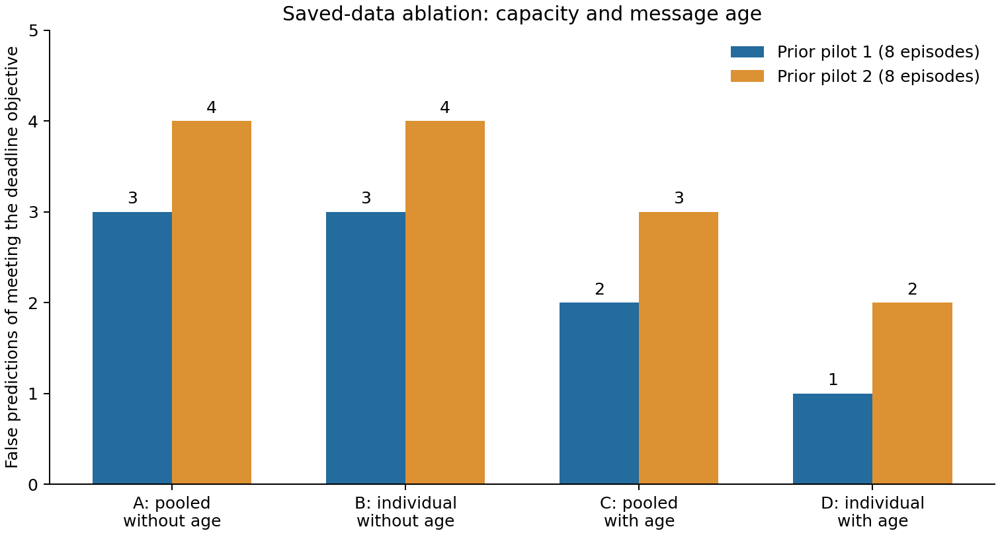
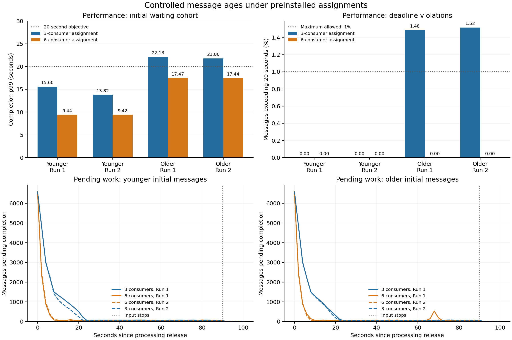

# Message age and individual consumer capacity

This record separates two questions: whether a prediction uses the right processing rate for each consumer, and whether it accounts for how long waiting messages have already been in the system. The existing pilots were reanalyzed in a four-way comparison. A subsequent Kafka diagnostic compared assignments that passed individual capacity checks, while changing the age of part of the initial queue.

These are diagnostic episodes, separate from the proposal's established performance-trial count. The live comparison installs final assignments before processing starts. It does not measure an actual scale-out, ownership transfer, or resource saving, and it does not validate a complete controller or establish novelty.

## Saved-data comparison

The original sixteen episodes were analyzed with the same assignment, same oldest-first service assumption, same waiting cohort and same 20-second deadline objective. A and C reproduce predictions saved before release. B and D are retrospective diagnostics using individual task rates measured before those episodes. The goal is at least 99% of the entire initial cohort completing within 20 seconds of creation; unfinished messages with expired deadlines count as violations.

| Diagnostic | Capacity assumption | Elapsed age included | False deadline successes, pilot 1 | Pilot 2 | Total |
| --- | --- | --- | ---: | ---: | ---: |
| A | Pooled task rate | No | 3 / 8 | 4 / 8 | 7 / 16 |
| B | Individual consumer task rates | No | 3 / 8 | 4 / 8 | 7 / 16 |
| C | Pooled task rate | Yes | 2 / 8 | 3 / 8 | 5 / 16 |
| D | Individual consumer task rates | Yes | 1 / 8 | 2 / 8 | 3 / 16 |

There were no false failures in this diagnostic. These counts describe the saved episodes; shared deployments and two repetitions do not support an independent-sample significance claim. The predictors are additional diagnostics, not numerical p99 predictions emitted by Ezzeddine's published rule. The [original rule audit](../message-age-20261030/baseline-audit.md) explains the reconstruction.

Using individual rates and age reduced errors but did not eliminate them. The original rule's assignment sent about 300 messages/s to a consumer with a measured task rate of about 285–287 messages/s. A per-consumer capacity check therefore already challenges recovery under continued input, regardless of age. A finite waiting cohort can nevertheless meet its deadline even when continued input is unsustainable; deadline success and sustained recovery are separate requirements.

## Controlled Kafka comparison

Both candidate assignments use all their consumers: twelve high-input partitions are distributed four per consumer with three consumers, or two per consumer with six. The other forty-eight partitions are distributed evenly. Input remains 600 messages/s, with 80% directed to the twelve high-input partitions. The resulting assigned input is 200 messages/s per original consumer or 100 messages/s per consumer in the six-consumer assignment. Fresh topics use replication factor one. Messages have 100-byte payloads and consumers execute the same sequential 2,000-iteration SHA-256 task. Connection-preparation markers occupy offset zero; measurement records begin at offset one.

Before comparisons, each consumer processes a large preloaded queue. Capacity is estimated from a specified 60-second measurement interval, seconds 10–70 after release. The interval must remain busy, contain no empty poll or processing gap above 250 ms, and have half-interval rates within 20%. Each assignment must keep every consumer's assigned input below 85% of its smaller half-interval rate. This is a conservative admission check based on one interval, not a statistical lower confidence bound or a guarantee of future capacity.

| Consumer | Effective calibration rate (msg/s) | Conservative admission rate (msg/s) | Consumer arrival rate with 3 (msg/s) | Consumer arrival rate with 6 (msg/s) |
| --- | ---: | ---: | ---: | ---: |
| 0 | 298.13 | 252.19 | 200 | 100 |
| 1 | 474.30 | 402.33 | 200 | 100 |
| 2 | 745.92 | 633.34 | 200 | 100 |
| 3 | 226.87 | 192.78 | 0 | 100 |
| 4 | 583.58 | 496.03 | 0 | 100 |
| 5 | 466.82 | 393.86 | 0 | 100 |

Every episode starts with 6,600 acknowledged messages: 500 in each high-input partition and 12 or 13 in each remaining partition. The preload contains 3,600 messages. Their ages are about 7–8 seconds in the younger condition and 15–16 seconds in the older condition. A common five-second input trace contributes another 3,000 messages aged about 1–6 seconds in both conditions. Thus the experiment changes the preload's age, not the age of every message. No initial message has already exceeded the 20-second deadline at release.

Creation times are real timestamps. Connections and topic metadata are prepared before production; fixed production and release schedules control age. The initial per-partition counts and recent input trace are the same across episodes. Continuing input lasts 90 seconds after release, followed by ten seconds without production. The two assignments and two age conditions are each repeated twice, reversing run order in the second repetition. All six pods remain allocated throughout; active counts cannot be used as measured resource savings.

## Completed eight-episode block

| Initial cohort | Assignment | Run | Completion p99 (s) | Deadline violations (%) | Unfinished at cutoff | Pending when input stops |
| --- | --- | ---: | ---: | ---: | ---: | ---: |
| Younger | Three consumers | 1 | 15.602 | 0.00 | 0 | 48 |
| Younger | Three consumers | 2 | 13.820 | 0.00 | 0 | 44 |
| Younger | Six consumers | 1 | 9.436 | 0.00 | 0 | 50 |
| Younger | Six consumers | 2 | 9.420 | 0.00 | 0 | 51 |
| Older | Three consumers | 1 | 22.126 | 1.48 | 0 | 59 |
| Older | Three consumers | 2 | 21.797 | 1.52 | 0 | 66 |
| Older | Six consumers | 1 | 17.468 | 0.00 | 0 | 55 |
| Older | Six consumers | 2 | 17.444 | 0.00 | 0 | 46 |

For younger preload messages, the three-consumer assignment met the deadline objective in 2 of 2 episodes, and the six-consumer assignment in 2 of 2. For older preload messages, the three-consumer assignment met the deadline objective in 0 of 2 episodes, and the six-consumer assignment in 2 of 2.

Completion p99 concerns the 6,600 messages waiting at release. Deadline percentages use that entire cohort. Pending at input end additionally includes continuing input that has not completed at second 90. The plots' pending-work curves reconcile known created and acknowledged records with distinct completions; they are not Kafka committed-offset lag.

The assignments passed their individual capacity checks and the pending-work curves show whether they recovered while input continued. The observation period is short and does not establish indefinite stability. A deadline failure for older records can coexist with subsequent low pending work and eventual completion of every message.

## Prediction limits

The false-success counts in the completed block are A: 2, B: 2, C: 2, D: 2. Even the individual-capacity, age-aware diagnostic retains the oldest-first assumption across partitions. Actual Kafka batches can process continuing-input messages from one partition before older initial messages in another partition. Saved processing starts and completions expose that difference; the per-consumer service-order diagnostics report continuing records completed before the final initial-cohort record. These are post-run explanations, not pre-action forecasts. Processing rates also vary between calibration and episodes, so the remaining error is not attributed entirely to processing order.

The results can demonstrate why successful backlog recovery does not by itself establish a waiting-message latency objective. They do not show that simply adding age produces a reliable decision rule, that a published method's overall findings are wrong, or that the proposed research is novel. A predictive improvement still needs a validated Kafka service model, measured transition behavior, and evaluation on separate conditions.

## Interrupted attempt retained

The preceding attempt completed six comparison episodes before the local Kubernetes exec connection reset. The producer pod did not restart. The runner stopped the probe and restored three replicas. All six completed episodes were reconciled and retained; the two unfinished scheduled comparisons are not counted as completed episodes. Because the added pods were removed during cleanup, a new calibration and full eight-episode block were used for the repeat rather than combining results across changed deployments.

| Initial cohort | Assignment | Run | Completion p99 (s) | Deadline violations (%) | Unfinished at cutoff | Pending when input stops |
| --- | --- | ---: | ---: | ---: | ---: | ---: |
| Younger | Three consumers | 1 | 13.279 | 0.00 | 0 | 62 |
| Younger | Six consumers | 1 | 9.377 | 0.00 | 0 | 61 |
| Older | Three consumers | 1 | 20.967 | 1.53 | 0 | 59 |
| Older | Three consumers | 2 | 22.053 | 1.48 | 0 | 57 |
| Older | Six consumers | 1 | 17.458 | 0.00 | 0 | 67 |
| Older | Six consumers | 2 | 17.463 | 0.00 | 0 | 60 |

The interrupted and complete blocks remain separate. Neither block is silently substituted for the other.

## Verification and evidence

Interrupted block: 6 completed episodes; 6 deadline classifications remain unchanged within measured clock bounds. After normalizing only the intended preload hold, the largest corresponding-message age difference was 3.192 ms.

Completed block: 8 completed episodes; 8 deadline classifications remain unchanged within measured clock bounds. After normalizing only the intended preload hold, the largest corresponding-message age difference was 3.157 ms.

Analysis verifies archive and executed-source hashes, distinct identifiers, acknowledgment/completion reconciliation, contiguous offsets after connection primers, ownership, sequential processing, common initial queue counts, actual age schedules, predictions saved before release, and unchanged original consumer pods. Calibration estimates are recalculated from the recorded completion times. Eight new calculation checks cover age accounting, deadline rank, partition ownership and rejection of underloaded or interrupted calibration intervals.

Raw archives remain outside Git, locally and in the run-specific cluster directories. Small summaries and evidence hashes are versioned here: [four-way analysis](ablation.json), [complete block](controlled-results.json), [interrupted block](interrupted-results.json), [backup verification](backup-verification.json), and [source manifest](source-manifest.json). The cluster is restored to three consumers and the managed experiment remains stopped after the diagnostic.
