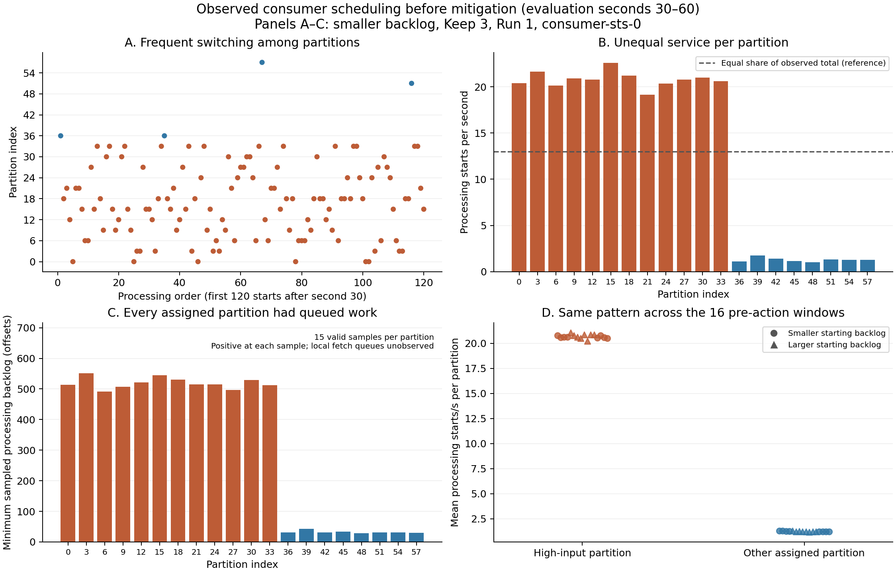

# Observed consumer scheduling

The saved completion records show unequal service across backlogged partitions, with frequent partition switches and occasional departures from message-creation order. Neither strict equal-share round-robin service nor perfect creation-time ordering describes the observations exactly. The records do not identify the internal fetch scheduler or validate a replacement scheduler.

This analysis uses the existing sixteen [starting-backlog comparison trials](../backlog-comparison-20261027/README.md). It adds no performance trials and changes no runtime behavior. Its purpose is to check the service assumptions in the [transition audit](../decision-rule-audit-20261029/README.md) before using those assumptions to predict an intervention's effect.

## Scope and findings

The reporting interval is evaluation seconds 30–60, before the scheduled intervention. All three original consumers are included: 48 consumer windows containing 171,846 recorded processing starts. This is one common reporting interval from each existing trial, not 48 independent experiments. Records produced during warm-up remain included if processing starts in this interval.

The initial assignment gives consumer-sts-0 the twelve high-input partitions and eight other partitions. Across its sixteen windows:

| Observation | Result |
| --- | --- |
| Total observed processing starts | 252.0–263.0 messages/s |
| Mean starts per high-input partition | 20.21–21.06 messages/s |
| Mean starts per other assigned partition | 1.18–1.28 messages/s |
| Adjacent records from the same partition | 13.0–19.7% |
| Longest same-partition sequence in a window | 5–45 records |
| Backlogged assigned partitions | All 20 were positive at all 15 valid samples in every window |

The rates describe observed application service, not maximum consumer capacity or distinct-message throughput. Means in the two partition rows are calculated over the twelve high-input or eight other partitions separately for each window; the table retains the range across those windows. A consecutive sequence can cross multiple `consume()` calls, so its length is not a fetch-batch size.

There were 380 creation-time backtracks exceeding 100 ms among 111,767 cross-partition comparisons in the overloaded consumer's same-producer subsequences. Of these, 39 exceeded one second; the largest was 1.983 seconds. Each comparison uses creation timestamps from the same producer process, avoiding differences between producer-node clocks. A backtrack means that a later-processed record had an earlier recorded creation time. It does not establish that this older record was already available in the consumer's local buffer when the earlier processing decision was made.

Within all 48 selected windows, offsets increased within each topic-partition and assignment epoch, and no overlapping or reversed processing timestamps were found. These observations concern only the selected records; they do not establish correctness of every handover or every message in the complete campaign.



Panels A–C show the smaller-backlog Keep 3 Run 1 example. High-input partitions receive approximately 20.8 starts/s each and the other assigned partitions approximately 1.3 starts/s each, despite positive processing backlog in every partition at every sample. The dashed line is an equal-share reference, not a fitted prediction. Panel D shows the same allocation pattern across the sixteen pre-action windows. The arm label identifies the later intervention; no intervention has occurred in these windows.

## Implications for prediction

The inspected consumer requests at most 25 messages per `consume()` call and processes the returned list sequentially. It does not sort that list by creation time or implement an application-side round-robin selector. Its source hash matches the recorded executable source in all 48 consumer windows; the recorded client version is Confluent Kafka Python 2.12.2.

The equal-share simulation gives each continuously nonempty partition one processing turn per cycle. That allocation differs markedly from the observed high-input versus other-partition service. However, monitoring captures Kafka-side processing backlog rather than every local-buffer state. Positive two-second samples do not prove that every partition was locally available at every processing instant. These observations therefore reject equal sharing as an exact description of the observed allocation, not any specific implementation inside librdkafka.

Perfect oldest-creation-time service is also too strong an assumption. Some older-created messages are processed after newer-created messages from the same producer. This does not show that the observed behavior is far from oldest-first on every timescale, or quantify the resulting error in a latency prediction. Fetch availability, batching and scheduling must be distinguished before making that claim.

The next measurement needed is the batch identifier, time returned by `consume()`, and position within the returned batch for each processed message, together with assignment events. Those observations would separate broker backlog from messages available to application processing. A different application-side scheduler would then require a separate controlled comparison; changing it now would introduce another intervention into the scaling study. No scheduler change is deployed by this analysis.

## Reproduction and validation

From the repository root, with the separately retained raw results present:

```bash
python3 -m unittest discover -s experiments/decision-rule-audit -p 'test_scheduling.py' -v
python3 experiments/decision-rule-audit/analyze_scheduling.py --repo . --output /tmp/consumer-scheduling
python3 experiments/decision-rule-audit/plot_scheduling.py /tmp/consumer-scheduling
```

Only the plot requires Matplotlib. Eight checks cover sequence statistics, producer-clock separation, assignment epochs, overlapping timestamps, empty streams, missing/stale monitoring, conflicting owners and interval boundaries. Two complete evidence reads reproduced the numerical summaries and hashes. Final consumer records reported no dropped evidence or writer failure for the selected processes. Monitoring samples require one observed owner, a valid lag measurement, observation age at most ten seconds, and finite nonnegative processing backlog; missing observations are not replaced with zero.

[Per-consumer summaries](consumer-summary.csv), [partition counts and trace excerpts](results.json), [evidence hashes](source-manifest.json), and [validation results](validation.json) are retained. Large raw event logs remain outside Git. This report does not alter the proposal's performance-trial count or turn the synthetic audit into experimental validation of a controller.
