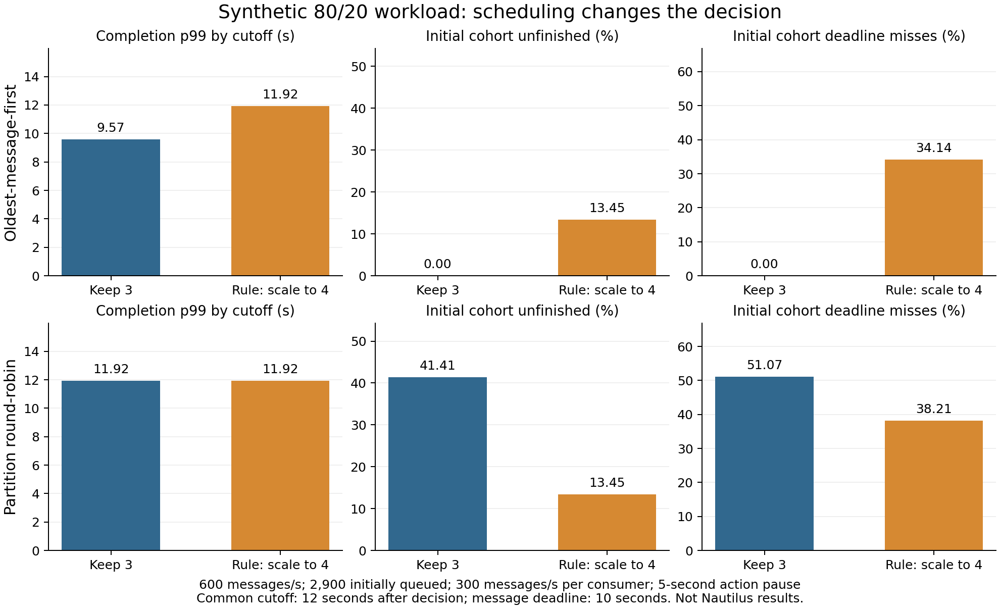

# Scaling and redistribution under skew: transition audit

This is a synthetic offline study, not a Nautilus experiment. It extends the [original decision-rule audit](../decision-rule-audit-20261028/README.md). It does not add trials to the proposal or establish a novel controller.

The published two-stage rule can select an action that worsens the initial waiting cohort in a constructed case. However, the proposed admission check also fails when the cross-partition service schedule changes. The useful result is therefore a verified limitation of this particular model and correction, not evidence that the correction is ready to deploy.

## What was checked

The full [Ezzeddine et al. 2025 paper](https://doi.org/10.1007/s42979-025-03740-9), pages 6-9, was checked against the reconstructed rule. It packs arrival rates and existing lag, decides whether an action is needed, and then repeats packing with the additional lag expected during rebalancing. The original audit's statement that this full paper was unavailable is now superseded.

The paper links to [Experience, branch no_elastic](https://github.com/fatimazahraelaaziz/Experience/tree/no_elastic). Source inspection pins commit `49331239a9c0acf362498d13c404bb0b7c88556a`. The repository contains several variants, and no inspected variant has been certified as the exact release used for the paper's experiments:

- `BinPacking/.../BinPackState.java` contains static simulation settings and a separate reassignment check that can overwrite an earlier action. It does not implement the paper's complete prospective-lag second stage.
- `restructuredbinpack/.../BinPackRestructureWithLag.java` adds an equal share of aggregate rebalance arrivals to five partitions. This differs from Equation 7's individual partition arrival rates.
- `restructuredbinpack/.../BinPackRestructureWithLagLag8p.java` adds an arrival-during-processing calculation to its decision logic. Its source is another variant, not a substitute for the paper's pseudocode.

The new implementation follows the published action branches. Packing retries with increasing numbers of initially empty bins, assigns higher-rate partitions first, and tries the least-loaded feasible bin. This uses the structure of the linked code but remains a reconstruction. The audit varies equal-rate item ordering and the bin-load priority. Oversized values may be capped for packing as in the linked code, but the original values are retained and checked afterward: a returned assignment is not automatically marked feasible. Reassignment also preserves the physical fleet when fewer packing bins are occupied; it does not silently become scale-down.

[Source hashes](source-manifest.json) distinguish the paper, the inspected public source, and the pipeline revision. The author controller was not executed or connected to a cluster.

## Workload and measurement

The constructed workload sends 600 messages/s to 60 partitions. Twelve receive 40 messages/s each and the remaining 48 receive 2.5 messages/s each, giving an 80/20 distribution. Three existing consumers each initially receive 200 messages/s. This differs from the completed Nautilus campaign in which the high-input partitions initially belonged to one consumer.

Each simulated consumer processes 300 messages/s. That is an illustrative round value near the slowest original consumer's recorded calibration, not a measured homogeneous capacity for six consumers. The original three capacity estimates were 286.875, 635.625 and 670.208 messages/s; added consumers remain uncalibrated. [Parameter provenance](parameter-evidence.json) keeps measurements separate from assumptions.

The smaller synthetic queue contains 2,900 messages: 2,490 in P0 and 410 in P3, both initially assigned to C0. The larger synthetic queue contains 5,800 messages in P0, P3 and P6, all initially assigned to C0. These initial messages are a stipulated burst created at decision time. Continuing periodic arrivals run for 30 seconds. The primary simulation uses sequential oldest-message-first service across assigned partitions while preserving FIFO order within each partition.

The rule uses a ten-second latency target and up/down factors of 0.9/0.4. A common observation cutoff is 12 seconds after the decision. Interventions impose a global processing pause of 0, 1, 3 or 5 seconds, following the paper's blocking assumption. These pauses are constructed values. The much longer recorded Nautilus activation durations include other work and are not substituted for global processing pauses.

All primary outcome counts refer to the messages already waiting at decision time. P99 uses only those completed by the cutoff and is reported with unfinished counts. Deadline misses include completed messages exceeding ten seconds and unfinished messages whose ten-second deadline has passed. Later diagnostic p99 values follow the initial cohort to completion and are separately named in the JSON/CSV. They are not used as the reported cutoff p99. Resource cost is consumer-seconds to the common cutoff, not measured CPU use or currency. Every provisioned consumer is charged from the decision, including the pause.

## Primary result

For the smaller synthetic queue, the canonical packing order gives:

| Response | Processing pause | Consumers | Completion p99 by cutoff | Unfinished at 12 s | Deadline misses known by cutoff |
| --- | ---: | ---: | ---: | ---: | ---: |
| Keep the assignment | 0 s | 3 | 9.570 s | 0 / 2,900 | 0 / 2,900 |
| Published branches: reassignment | 1 s | 3 | 9.203 s | 0 / 2,900 | 0 / 2,900 |
| Published branches: scale and reassign | 5 s | 4 | 11.917 s | 390 / 2,900 | 990 / 2,900 |
| Candidate admission check, five-second case | 0 s | 3 | 9.570 s | 0 / 2,900 | 0 / 2,900 |

In the five-second case, P0's projected lag is 2,490 + 40 x 5 = 2,690, below the 2,700-message packing limit. The destination assignment satisfies the reconstructed published constraints. Nevertheless, P0 alone needs 5 + 2,490 / 300 = 13.3 seconds to finish its original waiting messages under the assumed service schedule. Keeping the current assignment finishes the complete initial cohort in 2,900 / 300 = 9.667 seconds. Prospective backlog was included; the difference arises from elapsed interruption time and the service schedule for the already-waiting records.

The candidate admission check compares predicted initial-cohort deadline misses with and without the action, and rejects the action when the current assignment has sustainable continuing input and the action increases those misses. This is an intentionally narrow diagnostic check, not a general cost optimizer or a new complete controller.

Keeping the assignment is not always preferable. With the larger synthetic queue and a five-second pause, the reconstructed rule scales to four consumers and reduces unfinished initial-cohort messages from 2,200 to 600 and known deadline misses from 2,800 to 1,800. With a one-second pause, both synthetic queue sizes benefit from reassignment. Fixed redistribution-to-three and targeted scale-to-six alternatives are also evaluated in [outcomes.csv](outcomes.csv). The published rule chooses its own count; it is not forced to choose six. In these particular fixtures, extra consumers beyond the separated backlog-bearing partitions do not further reduce initial-cohort completion times under the stipulated schedule.

## The admission check fails under another service schedule

With the same smaller queue, capacities and five-second action pause, change only the consumer schedule to one message per nonempty partition in round-robin order:

| Response | Completion p99 by cutoff | Unfinished at 12 s | Deadline misses known by cutoff |
| --- | ---: | ---: | ---: |
| Keep the assignment | 11.917 s | 1,201 / 2,900 | 1,481 / 2,900 |
| Reconstructed rule: scale to four | 11.917 s | 390 / 2,900 | 1,108 / 2,900 |

Here, rejecting the intervention increases both unfinished work and deadline misses. The simple admission check still assumes oldest-message-first service and therefore makes the wrong choice. This unfavorable result is retained.

The active consumer reads a batch with `consume()` and processes the returned messages sequentially. It does not globally sort assigned-partition messages by creation time. Neither simulated discipline has been established as an exact model of librdkafka's batching and delivery in the experiments. The service assumption must therefore be checked against saved per-partition completion order before this admission rule is considered for Kafka.



## Validation and limits

Ten unit checks cover hand-calculated queues, cutoff censoring, message age, partial partition availability, replica accounting, oversized partitions, short/long pause behavior, analytical-versus-event agreement, and the scheduling reversal. The original audit's seven assertion groups also pass. The complete output is deterministic across two executions.

Packing sensitivity examines 66 equal-rate tie orders for each of two bin priorities, two up factors and four pause values (1,056 checks). The primary 0.9-factor cases satisfy the original projected constraints. Depending on ties, the five-second smaller case requests four to twelve consumers, but its initial-cohort deadline regression persists under oldest-first service. The 0.8-factor cases contain an oversized initial partition and are explicitly marked infeasible; they are not counted as evidence that a valid assignment fails its stated constraint.

Queue sensitivity covers two schedules, actual capacities of 240, 300 and 360 messages/s, and initial message ages of zero or five seconds. The decision model continues to assume capacity 300. These are assumption checks, not independent statistical repetitions. They show why queue size alone does not establish age, deadline outcomes or the service received by each partition.

The audit uses one decision and fixed subsequent assignments. It omits broker/network delays, stochastic task times, duplicates, commit behavior, CPU contention and feedback from future controller decisions. The mathematical initial-cohort predictor and simulator agree under the same specified service assumptions; that agreement is not empirical validation of Kafka. The paper does not promise zero deadline violations in every state, and the audit does not invalidate its overall findings.

The next evidence needed is a replay or direct measurement of per-partition service during continuing skewed input and handover. A predictor that handles this scheduling effect should then be compared with the existing rules on separate cases. No validated novel controller claim follows from this audit yet.

## Reproduce

From the repository root, using Python 3:

```bash
python3 -m unittest discover -s experiments/decision-rule-audit -p 'test_transition_audit.py' -v
python3 experiments/decision-rule-audit/transition_audit.py --output /tmp/transition-audit
python3 experiments/decision-rule-audit/plot_transition.py /tmp/transition-audit
```

Only the optional plot command requires Matplotlib. The audit itself uses the Python standard library. [Results](results.json), [outcome rows](outcomes.csv), [validation](validation.json), [parameter evidence](parameter-evidence.json), and [source manifest](source-manifest.json) are retained here. No credentials, third-party source, or raw experiment logs are included.
