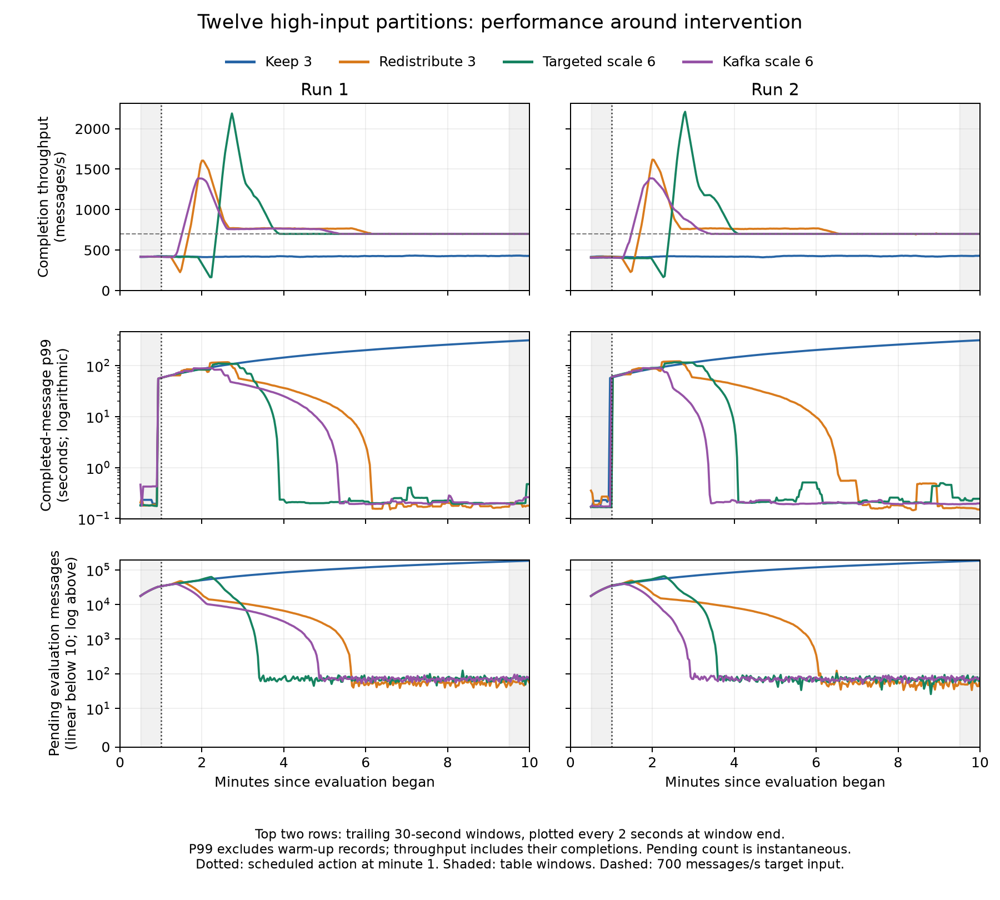

# Performance before intervention and at evaluation end

Retrospective completion-window diagnostic for the eight twelve-high-input-partition trials; not a replacement for whole-evaluation production-cohort outcomes.

Throughput counts earliest distinct completions in [left,right), including warm-up records; p99 uses individual latencies of acknowledged evaluation-born messages whose earliest completion falls in that interval. Nearest rank; no averaging of percentiles. Completion precedes commit acknowledgment.

Before: evaluation seconds [30,60). Evaluation end: [570,600). Post-action: [verified activation,600), using explicit active_verified or a native six-owner map confirmed unchanged for ten seconds; Keep 3 uses second 60 as its no-action reference. Activation is not backlog recovery. No window includes drain. Rolling traces use trailing 30-second windows at 2-second steps, plotted at the window end.

| Response | Run | Before throughput (msg/s) | End throughput (msg/s) | Before p99 (s) | End p99 (s) | Pending evaluation messages, before / end |
|---|---:|---:|---:|---:|---:|---:|
| Keep 3 | 1 | 423.800 | 427.733 | 57.137 | 313.206 | 33,419 / 182,654 |
| Keep 3 | 2 | 420.233 | 430.100 | 58.064 | 313.977 | 33,875 / 183,386 |
| Redistribute 3 | 1 | 419.667 | 700.433 | 57.357 | 0.179 | 33,513 / 54 |
| Redistribute 3 | 2 | 416.933 | 699.800 | 0.231 | 0.149 | 34,967 / 72 |
| Targeted scale 6 | 1 | 421.133 | 700.033 | 57.295 | 0.472 | 33,506 / 65 |
| Targeted scale 6 | 2 | 408.767 | 699.700 | 0.167 | 0.244 | 34,962 / 77 |
| Kafka scale 6 | 1 | 418.500 | 699.933 | 57.470 | 0.262 | 33,587 / 70 |
| Kafka scale 6 | 2 | 407.167 | 699.967 | 59.564 | 0.198 | 34,786 / 78 |

## From verified activation to evaluation end

| Response | Run | Start (evaluation s) | Duration (s) | Throughput (msg/s) | Completion p99 (s) | Evaluation completions for p99 |
|---|---:|---:|---:|---:|---:|---:|
| Keep 3 | 1 | 60.000 | 540.000 | 423.641 | 309.904 | 228,766 |
| Keep 3 | 2 | 60.000 | 540.000 | 423.130 | 310.887 | 228,490 |
| Redistribute 3 | 1 | 92.552 | 507.448 | 787.195 | 80.031 | 399,461 |
| Redistribute 3 | 2 | 93.122 | 506.878 | 790.264 | 84.592 | 400,567 |
| Targeted scale 6 | 1 | 139.829 | 460.171 | 810.679 | 94.965 | 373,051 |
| Targeted scale 6 | 2 | 144.227 | 455.773 | 816.644 | 99.008 | 372,204 |
| Kafka scale 6 | 1 | 98.000 | 502.000 | 757.380 | 66.090 | 380,205 |
| Kafka scale 6 | 2 | 100.000 | 500.000 | 753.896 | 57.172 | 376,948 |

Only completed evaluation records contribute to window p99. Pending records are reported alongside it. Post-action durations vary with activation time and exclude the preceding action transition; they do not measure total intervention cost. The interval includes previously queued messages and subsequent backlog recovery. Latency uses original unadjusted producer and consumer clocks, so small differences require caution. Later recovery must not be inferred from p99 alone.

All original event and summary hashes were checked against the published comparison. Activation boundaries were checked against the retained handoff journals or lag snapshots and the original transition summary; journal hashes are retained. Admission, completion, unfinished, whole-run p99 and throughput were replayed and matched before calculating windows.



Reproduce from the retained raw evidence at the repository root:

```bash
python3 experiments/four-condition-20260929/analyze_action_windows.py \
  experiment-records/four-condition-20260929/comparison.json \
  --output /path/to/analysis-output
```

The output directory contains the numerical record, table rows and PNG/PDF plots. No cluster access or new performance trial is required.
