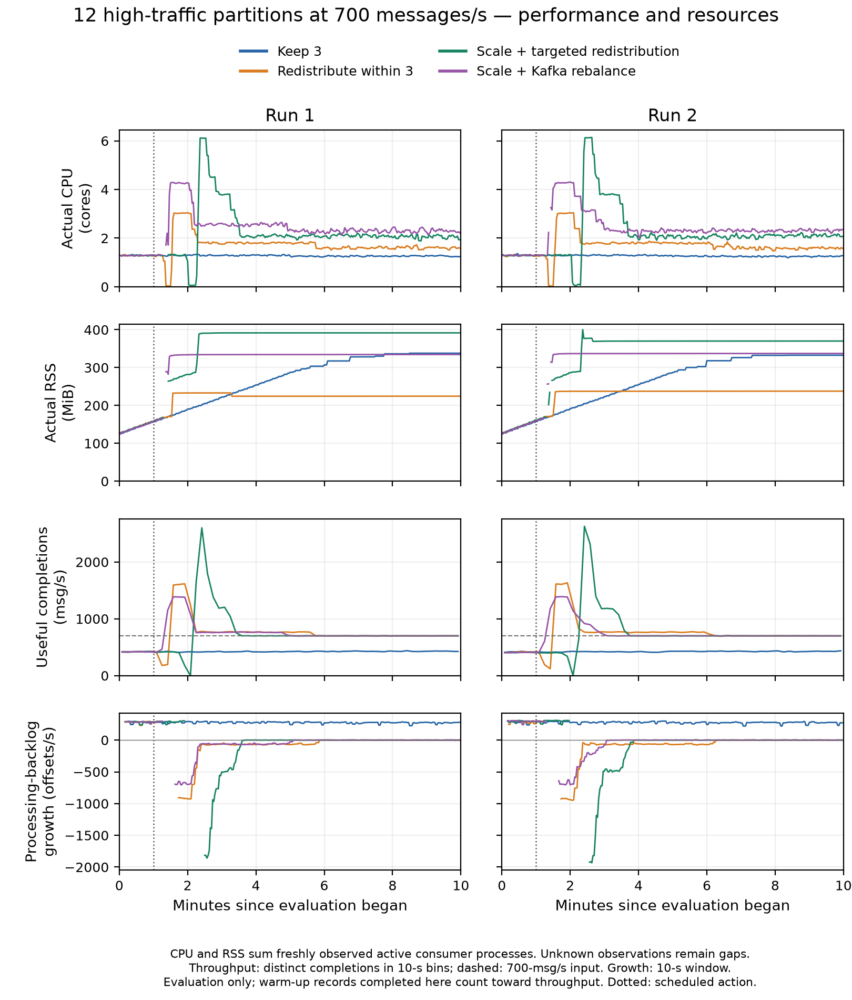

# Twelve hot partitions: eight trials

Each trial used 700 aggregate messages/s, sixty partitions, and one-minute warm-up, ten-minute evaluation and two-minute drain. The action was scheduled one minute into evaluation. Each response has two separate trials with verified matching starting conditions.

| Response | p99 Run 1 / Run 2 (s) | Unfinished Run 1 / Run 2 (%) |
|---|---:|---:|
| Keep three | 366.64 / 362.79 | 34.64 / 34.83 |
| Redistribute within three | 80.10 / 84.16 | 0.00 / 0.00 |
| Targeted scaling to six | 100.81 / 107.24 | 0.00 / 0.00 |
| Native Kafka scaling to six | 71.41 / 72.46 | 0.00 / 0.00 |

All three interventions completed every evaluation message in both runs; keeping the initial assignment left about 35% unfinished. Native scaling recorded the lowest whole-cohort p99 in this block. Redistribution used fewer requested consumer resources than scaling. The first baseline has insufficient resource-request coverage for a full-window requested-cost comparison; its cost is unavailable, not zero. Coordination mechanisms differ between native and targeted responses.

[Original numerical comparison and provenance](comparison.json) · [Late-cohort analysis](post-recovery-comparison.json) · [Detailed metrics and plots](../result-metric-audit-20260930/README.md) · [Protocol](../../experiments/four-condition-20260929/README.md)

[Minimum and maximum completion latencies](completion-latency-extremes.json) were recovered from the same distinct-message cohort using the original drain cutoff. The replay reproduced the published mean, p99 and completion counts for all eight trials; its evidence hashes are included in that record. These extremes exclude unfinished messages.

[Sampled lag minima](lag-minima.json) add the minimum total backlog and the minimum individual partition lag during evaluation. These use the same valid observations as the reported peaks; a zero partition minimum does not mean that all partitions were caught up. Source hashes are included in the record.

[Mean backlog before mitigation](pre-mitigation-backlog.json) uses 15 valid measurements at evaluation seconds 30, 32, ..., 58, before the scheduled action at one minute. Keep 3 uses the same interval. This arithmetic mean describes recent backlog before mitigation; the mean total backlog in the results table remains a time-weighted average over the full evaluation. The record includes the selected observations and their source hashes.

[Mean backlog at evaluation end](end-evaluation-backlog.json) uses the final 15 samples at seconds 570, 572, ..., 598, while input continues. The mitigation runs ended with means of 37.7–60.1 offsets; Keep 3 ended with 177,266.3 and 178,040.4 offsets. The much larger full-evaluation means include accumulation and recovery earlier in the trials. The outcome plot uses logarithmic spacing above one for backlog and unfinished-message counts so that these small positive values remain visible.

The same record includes total backlog at the last sample (second 598). Table 5 calls these two values **Eval. end mean backlog** and **Eval. end total backlog**. The Keep 3 reference uses the same times. Minimum total backlog is retained in the analysis and commented out of the displayed table.

P99 covers completed evaluation messages through the fixed drain cutoff, before commit acknowledgment. Unfinished percentage uses all acknowledged evaluation messages. Small repetition counts and shared-machine variability limit generalization.
