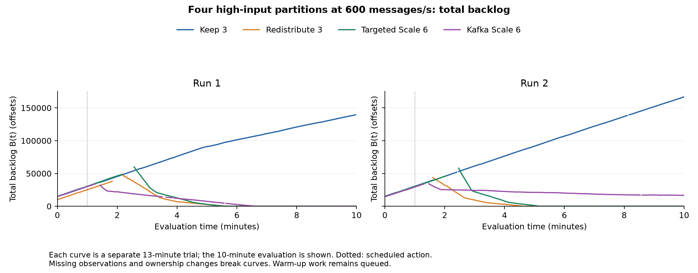
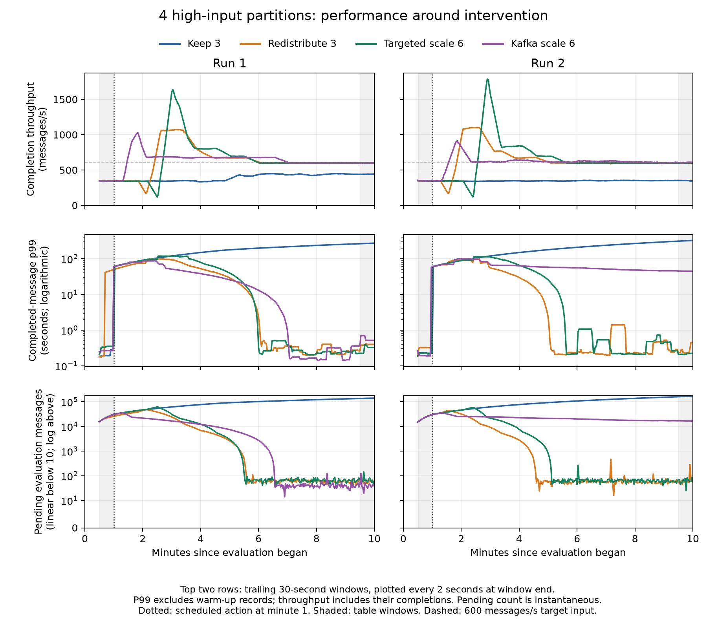
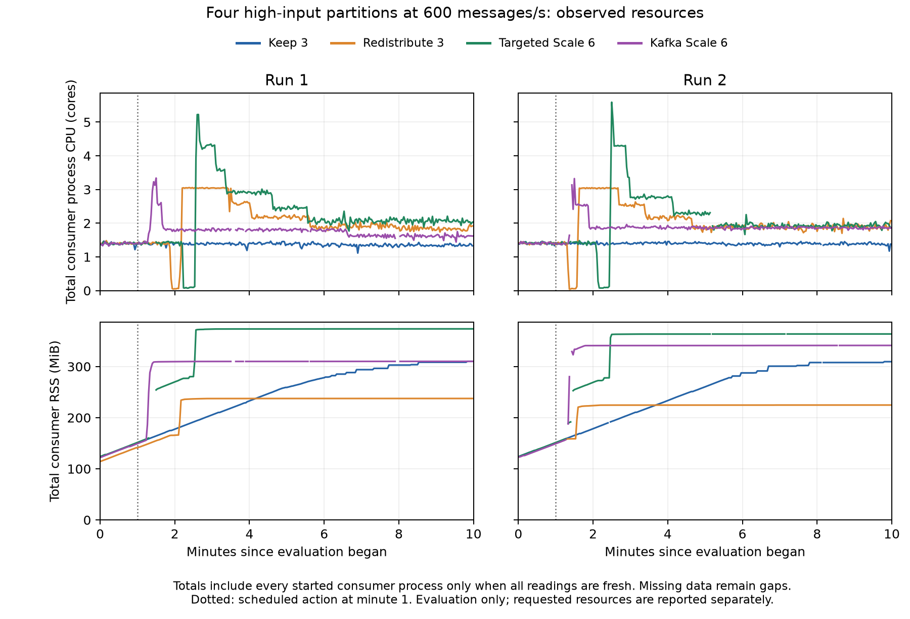

# Four high-traffic partitions at 600 messages/s

Eight trials compared four scheduled responses after a separate balanced calibration of the revised deployment. Each response was tested twice; Run 2 reversed condition order. These results are separate from the historical 700 messages/s comparisons.

Three producers targeted 200 messages/s each. Eighty percent of input was distributed over four of sixty partitions, initially on Consumer 2. Each trial used 1 minute of warm-up, 10 minutes of evaluation and 2 minutes of drain, with a scheduled action at evaluation second 60. Each admitted 360,000 evaluation messages.

| Response | Run | Completion p99 (s) | Unfinished (%) | One-second SLO violations (%) |
|---|---:|---:|---:|---:|
| Keep 3 | 1 | 309.29 | 26.92 | 85.66 |
| Keep 3 | 2 | 378.35 | 37.57 | 85.70 |
| Redistribute 3 | 1 | 91.82 | 0.00 | 38.76 |
| Redistribute 3 | 2 | 83.29 | 0.00 | 31.32 |
| Targeted Scale 6 | 1 | 114.08 | 0.00 | 36.75 |
| Targeted Scale 6 | 2 | 109.42 | 0.00 | 33.43 |
| Kafka Scale 6 | 1 | 75.59 | 0.00 | 44.35 |
| Kafka Scale 6 | 2 | 90.28 | 0.00 | 66.75 |

All three interventions completed the evaluation set in both runs. Kafka scaling had the lowest p99 in Run 1; redistribution within three consumers had the lowest in Run 2. Targeted scaling had higher p99 than redistribution in both runs. Keep 3 left 96,913 and 135,237 messages unfinished.

Completion by the drain cutoff is distinct from recovery under continuing input. Kafka scaling in Run 2 did not meet the prespecified recovery criterion: processing backlog at or below 100 offsets for 30 consecutive seconds. It still had 16,745 evaluation messages pending at evaluation end, although they finished during drain.

Redistribution requested 72 core-minutes and 27 GiB-minutes in each run. Scaling requested about 136.5–137.0 core-minutes and 51.2–51.4 GiB-minutes over evaluation plus drain. Allocation-record coverage was 100%; valid lag coverage was 94.0–99.7%. Actual process CPU and RSS remain separate from requests.

## Measurement and interpretation

Whole-run latency uses distinct acknowledged evaluation messages completed by the fixed drain cutoff, before commit acknowledgment. Unfinished work and SLO violations use the full evaluation cohort. Window p99 uses messages completed inside the stated interval and is not an average of percentiles. Throughput includes warm-up work completed during the window. A small before-window p99 can omit slow evaluation messages that have not completed yet.

[Completion windows](ACTION_WINDOWS.md) and [all before/after metrics](BEFORE_AFTER.md) retain throughput, latency, pending work, backlog, growth, skew, actual CPU/RSS, requested resources and coverage. Before is evaluation seconds 30–60; evaluation end is 570–600; the longer post-action interval starts at verified activation and ends at second 600. Activation is not recovery. Missing observations remain missing.

The original client pods, nodes, resource declarations and initial partition ownership were verified before traffic. Producer–consumer separation applied within the namespace, while other workloads could share those nodes. All eight trials passed identity, completion and offset checks. Technical preparations and calibration are excluded from this trial count. Two runs per response and shared-machine variability limit generalization. These are scheduled interventions, not an adaptive-controller evaluation or a hot-key-splitting experiment.

## Evidence and reproduction

[Numerical results](results-summary.json), [completion windows](completion-windows.json), [signal windows](signal-windows.json) and [evidence hashes](evidence-hashes.json) identify the saved measurements. Large raw records remain in separately retained storage; these summaries are not a backup of them.

The [experiment protocol and analysis commands](../../experiments/four-hot600-20261021/README.md) describe reproduction from the retained raw files. Historical execution revisions remain unchanged.
