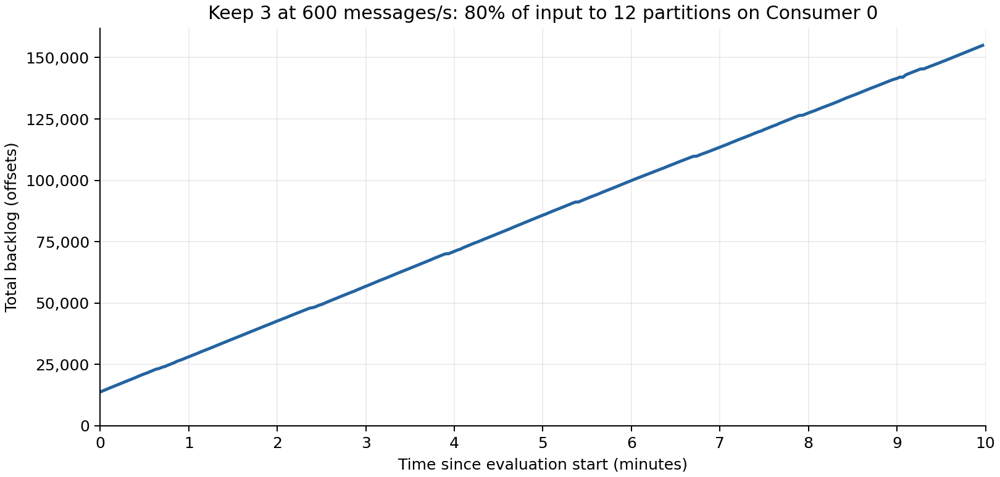

# Consumer 0 Keep 3 stress control

Run `run-20261104-073554` completed one no-mitigation trial at 600 total messages/s. Twelve of 60 partitions received 80% of input and initially belonged to Consumer 0. Three consumers retained their assignments throughout 1 minute of warm-up, 10 minutes of evaluation and 2 minutes of drain. The [declared deployment](deployment-plan.json) records the current nodes and differences from the earlier reference. This is a separate deployment block, not a matched continuation of the earlier trials.

| Outcome | Value |
|---|---:|
| Acknowledged evaluation messages | 360,000 |
| Achieved input | 600.00 messages/s |
| Throughput during evaluation | 363.99 messages/s |
| Completed by drain cutoff | 236,158 |
| Unfinished at drain cutoff | 123,842 (34.40%) |
| p99 end-to-end latency among completed evaluation messages | 363.357 s |
| One-second SLO violation rate | 83.37% |
| Last valid evaluation lag, at 598.0 s | 154,976 offsets |

Latency follows acknowledged evaluation messages through drain and excludes unfinished messages from the percentile. SLO violations include unfinished evaluation messages whose deadlines expired. Throughput counts distinct completions during evaluation, including warm-up messages completed in that period.

Backlog grew by 232.43, 234.25 and 232.03 offsets/s across the final three one-minute windows. All three windows passed the prespecified stress check. Valid lag coverage over evaluation was 99.67%. This control demonstrates sustained overload under the recorded skew and placement. It does not establish a general capacity limit or compare mitigation outcomes.

Message reconciliation and run validation passed. The runner restored the original shared configuration, stopped producer and consumer applications, and launched no subsequent trial. Raw logs, monitoring exports, timestamps and node records remain outside Git under the run ID, with a verified second local copy. [The summary](summary.json) includes evidence hashes and the execution revision `40056bcc8030be52fab77fa07b9036685440fdc9`. Existing proposal results and their trial counts are unchanged.
