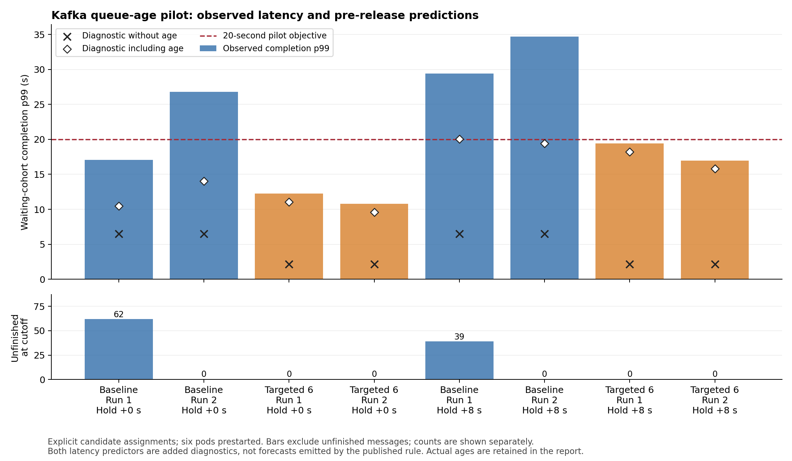
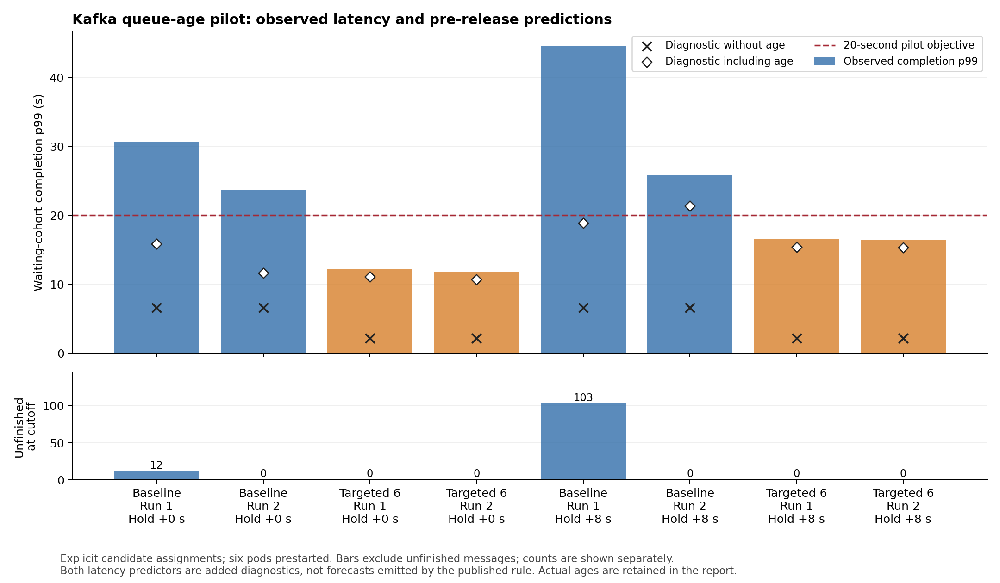

# Message age, capacity and assignment: pilot results

The two completed Kafka pilots contain eight episodes each. They test a paper-based assignment rule and a targeted six-consumer assignment under younger and older waiting cohorts. The results support including elapsed age in latency accounting, but they do not establish an age-only decision improvement or a validated new controller. These sixteen diagnostic episodes are separate from the proposal's established performance trials.

An additional preparation stopped before calibration or comparison traffic because newly created topic metadata had not propagated. The preparation was retained, the runner was corrected to wait for metadata readiness, and the three-replica starting configuration was restored.

## Experimental controls

Every comparison episode began with exactly 6,600 acknowledged records, with matching counts in every partition. Continuing input was approximately 600 messages/s, with 80% directed to twelve of sixty partitions. The two conditions added zero or eight seconds of holding before an identical final five-second preparation trace. Actual message ages were recorded: producer delivery and topic startup also contributed to age, so the conditions are not described as exactly zero and eight seconds old.

The original three pods, node placement and resource settings remained unchanged within each pilot. The six workers were prepared before measurement, and the final assignments were installed before processing was released. This isolates behavior under candidate assignments; it does not measure an actual scale-out or ownership-transfer transition. All six pods remained allocated throughout. No resource-cost saving is inferred from the number of active consumers.

The waiting cohort was followed for 30 seconds after release, with continuing input for the first 20 seconds. The diagnostic objective required at least 99% of the waiting cohort to complete within 20 seconds of message creation. Unfinished records count as deadline violations here because every initial record had passed that deadline by the cutoff. This objective does not replace the proposal's SLO.

## Baseline and prediction

The reconstructed rule preserves Ezzeddine et al.'s published two-stage action logic, including pooled processing capacity and prospective lag. The exact packing choices remain documented assumptions; the implementation is not certified as the authors' experimental release. [The rule audit](baseline-audit.md) lists the correspondence and limitations.

In both pilots, the rule returned reassignment while retaining a three-consumer fleet. Its packing used only two consumers, leaving the third without assigned partitions. The comparison therefore is not a balanced three-consumer assignment versus six consumers. The pooled task rate was approximately 500 messages/s, while Consumer 0 processed approximately 285–287 messages/s in the preliminary diagnostic. Assigning that consumer about 300 messages/s overestimated its available processing capacity. This is already a reason to question recovery under continued input, independently of message age.

Two additional numerical latency diagnostics were saved before release. Both assumed the same pooled capacity and oldest-first processing across assigned partitions; one ignored elapsed message age and the other included it. These p99 estimates are not predictions emitted by the published rule. Actual consumers processed Kafka batches sequentially without globally sorting messages by creation time. Predicted p99 covers the full waiting cohort; observed p99 uses completions recorded by the cutoff. The pass/fail check uses the entire cohort, including unfinished records, rather than comparing conditional p99 alone.

## First pilot

| Added hold | Response | Run | Actual age p99 (s) | Completion p99 (s) | Unfinished | Deadline violations (%) |
| --- | --- | ---: | ---: | ---: | ---: | ---: |
| 0 s | Rule: 3 retained, 2 active | 1 | 6.950 | 17.076 | 62 | 0.94 |
| 0 s | Rule: 3 retained, 2 active | 2 | 10.517 | 26.821 | 0 | 9.58 |
| 0 s | Targeted assignment: 6 active | 1 | 9.893 | 12.251 | 0 | 0.00 |
| 0 s | Targeted assignment: 6 active | 2 | 8.430 | 10.767 | 0 | 0.00 |
| 8 s | Rule: 3 retained, 2 active | 1 | 16.523 | 29.429 | 39 | 25.33 |
| 8 s | Rule: 3 retained, 2 active | 2 | 15.897 | 34.679 | 0 | 22.20 |
| 8 s | Targeted assignment: 6 active | 1 | 17.067 | 19.420 | 0 | 0.00 |
| 8 s | Targeted assignment: 6 active | 2 | 14.634 | 16.969 | 0 | 0.00 |

The age-blind diagnostic falsely predicted meeting the objective in 3 of eight episodes; including age reduced this to 2. All eight observed pass/fail classifications remain unchanged within the measured clock-offset bounds.

## Repeat with preparation checks

| Added hold | Response | Run | Actual age p99 (s) | Completion p99 (s) | Unfinished | Deadline violations (%) |
| --- | --- | ---: | ---: | ---: | ---: | ---: |
| 0 s | Rule: 3 retained, 2 active | 1 | 12.309 | 30.598 | 12 | 12.82 |
| 0 s | Rule: 3 retained, 2 active | 2 | 8.077 | 23.714 | 0 | 5.97 |
| 0 s | Targeted assignment: 6 active | 1 | 9.907 | 12.246 | 0 | 0.00 |
| 0 s | Targeted assignment: 6 active | 2 | 9.507 | 11.858 | 0 | 0.00 |
| 8 s | Rule: 3 retained, 2 active | 1 | 15.309 | 44.491 | 103 | 25.15 |
| 8 s | Rule: 3 retained, 2 active | 2 | 17.836 | 25.757 | 0 | 31.11 |
| 8 s | Targeted assignment: 6 active | 1 | 14.240 | 16.587 | 0 | 0.00 |
| 8 s | Targeted assignment: 6 active | 2 | 14.118 | 16.388 | 0 | 0.00 |

The age-blind diagnostic falsely predicted meeting the objective in 4 of eight episodes; including age reduced this to 3. All eight observed pass/fail classifications remain unchanged within the measured clock-offset bounds.

## Interpretation

Adding age reduced latency underestimation, but the simple correction still missed unfavorable outcomes. The pooled capacity estimate and the assumed processing order remain material limitations. In addition, the realized age distributions differed across episodes despite identical nominal holding conditions. These data therefore do not isolate message age as the reason to prefer a different action under a joint recovery-and-latency objective.

The result is not evidence that the published paper's overall findings are wrong. Its lag constraint is intended to help control waiting time, and the paper acknowledges violations. A stronger comparison must first enforce or model per-consumer capacity, include matched age distributions and actual service behavior, and evaluate the same recovery and latency objectives. The existing rule should then be compared with an age-aware change and an age-blind ablation using the same feasible candidates and transition mechanism.

No additional full performance campaign or production controller was launched. Hot-key splitting was not used. The pilot does not justify a novelty claim or changes to the proposal's main results.

## Validation and retained evidence

Ten existing queue checks and four new age checks passed. The offline sensitivity sweep retained 72 outcome cases, including successful original-rule decisions and cases where neither response met the objective. The raw Kafka analysis independently reconciled acknowledgments and completions, verified distinct identifiers, contiguous partition offsets, sequential processing, assignment ownership, identical initial queue counts, and prediction timestamps preceding release.

Raw archives remain outside Git and on the cluster; [backup verification](backup-verification.json) records their hashes. The small summaries, executed-source hashes and plots are versioned here. [First-pilot data](first-pilot.json), [repeat data](second-pilot.json), [offline cases](offline-results.json), and [source provenance](source-manifest.json) retain the individual outcomes. The cluster was restored to three ready consumers and the managed run remained stopped.

The [capacity-and-age follow-up](../capacity-age-20261030/README.md) separates pooled-capacity and age assumptions, then tests assignments that pass individual capacity checks with controlled message ages.
