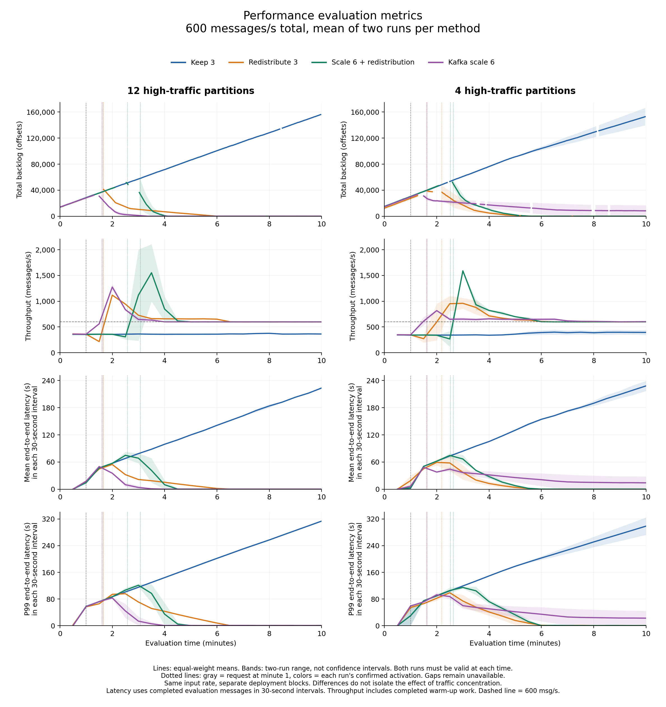
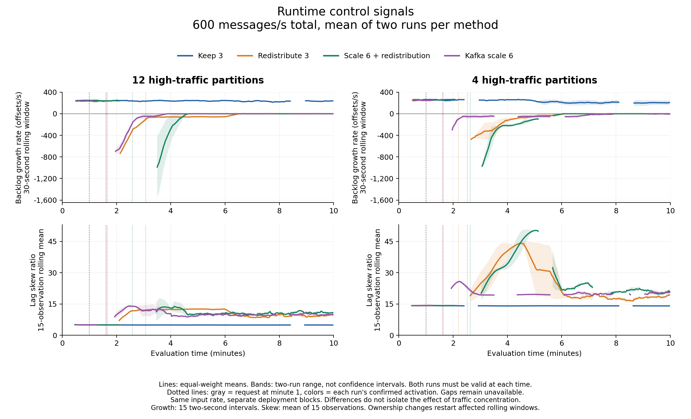
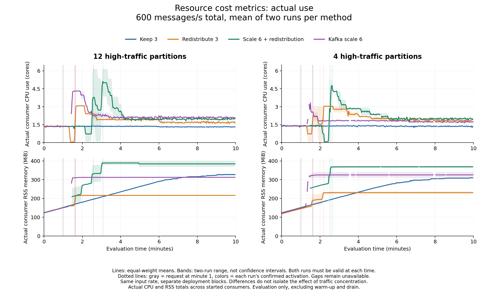

# Four and twelve high-traffic partitions at 600 messages/s

This comparison shows the two-run means for each response in two separate eight-trial blocks. The left column contains the twelve-partition Consumer 0 trials from November 4. The right column contains the four-partition trials from October 21. Both use 600 total messages/s, 60 partitions, 80% concentrated input, and the same 60-second warm-up, 600-second evaluation and 120-second drain schedule.

The results compare observed deployments. They do not isolate partition count as the only cause of performance differences. The initial overloaded consumer ran on k8s-chase-ci-04 in both blocks, but was Consumer 2 in the four-partition block and Consumer 0 in the twelve-partition block. Other producer and consumer placements differed. Original deployment and source records are retained in the figure data.

Each curve gives equal weight to Run 1 and Run 2 at a common evaluation time. Both must have valid values. Shading is the observed range, not a confidence interval. Missing values remain gaps. Gray dotted lines mark the request at minute 1 and colored dotted lines mark confirmed activation in each run. Axes are shared within each metric row.

## Performance evaluation metrics

Backlog, throughput, mean end-to-end latency and p99 are shown below. Completion windows are consecutive nonoverlapping 30-second intervals selected from the original measurements. Latencies use evaluation messages completed within each interval. Throughput also includes warm-up messages completed during evaluation. A mean of two p99 values is not the p99 of pooled messages.

Whole-run latency summaries below follow evaluation messages through drain, and are accompanied by unfinished percentages. These are different from the completion-window curves. Each table entry is the equal-weight mean of the two run-level values.

| High-traffic partitions | Method | Mean latency (s) | Mean run p99 (s) | Unfinished (%) | Throughput (msg/s) | Mean total backlog (offsets) |
|---:|---|---:|---:|---:|---:|---:|
| 12 | Keep 3 | 160.12 | 366.12 | 34.78 | 362.43 | 85,732.4 |
| 12 | Redistribute 3 | 13.31 | 84.00 | 0.00 | 623.89 | 7,781.8 |
| 12 | Scale 6 + redistribution | 18.35 | 115.37 | 0.00 | 623.74 | 10,081.4 |
| 12 | Kafka scale 6 | 7.35 | 68.23 | 0.00 | 623.77 | 4,902.2 |
| 4 | Keep 3 | 169.57 | 343.82 | 32.24 | 369.66 | 87,902.0 |
| 4 | Redistribute 3 | 15.16 | 87.55 | 0.00 | 621.37 | 8,701.1 |
| 4 | Scale 6 + redistribution | 20.56 | 111.75 | 0.00 | 625.69 | 11,644.4 |
| 4 | Kafka scale 6 | 25.55 | 82.94 | 0.00 | 611.53 | 15,649.7 |

## Runtime control signals

Backlog growth uses the same 15 valid two-second intervals in both blocks. Negative values indicate draining backlog. Lag skew uses the 15-observation rolling mean within each run. Both calculations restart after missing data or ownership changes.

## Resource cost metrics: actual use

CPU cores and RSS memory are measured process use, summed across every started consumer before averaging the two runs. Missing or stale components invalidate the total. These are not resource requests or monetary costs.

## Reproducibility

[Numerical means, individual run values, sample standard deviations and coverage](mean-results.json) and [compressed figure data](comparison-plot-data.json.gz) preserve all sixteen run IDs and the source hashes. Resource summary means are time-weighted over jointly observed evaluation intervals, with coverage retained. Backlog and skew summary means use valid original samples. Their averages need not equal an average of the plotted rolling curves.

The analysis script is `experiments/twelve-hot600-20261104/compare_partition_means.py`. It verifies the original completion replay, source hashes, and previously saved throughput/p99/resource traces. It recomputes growth from original lag samples, selects exact completion windows without averaging overlapping windows, and retains the original twelve-partition plot data. Three focused tests cover window selection, missing observations, and resource coverage.

These figures are prepared for review and have not been inserted into Overleaf.
