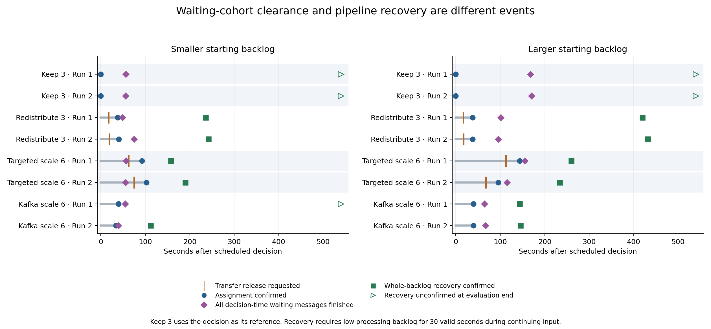
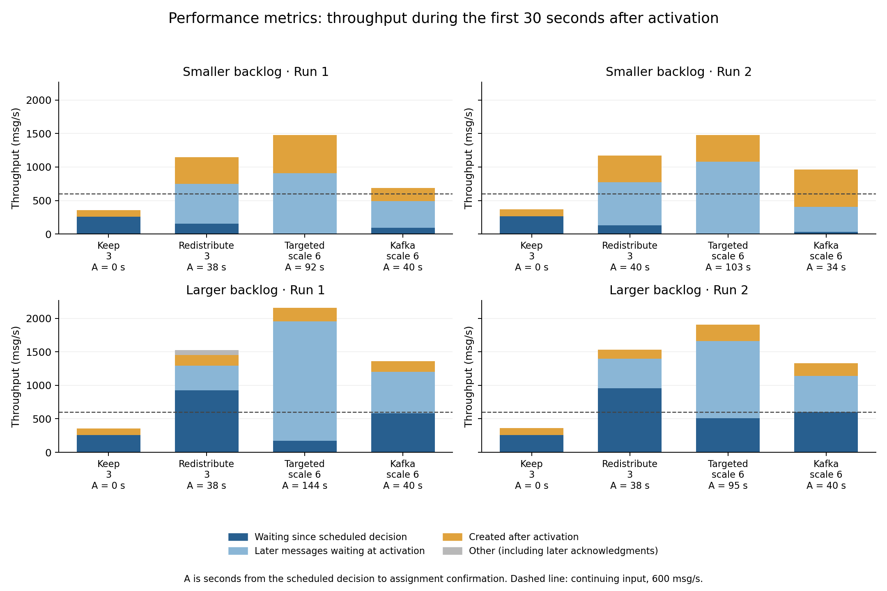
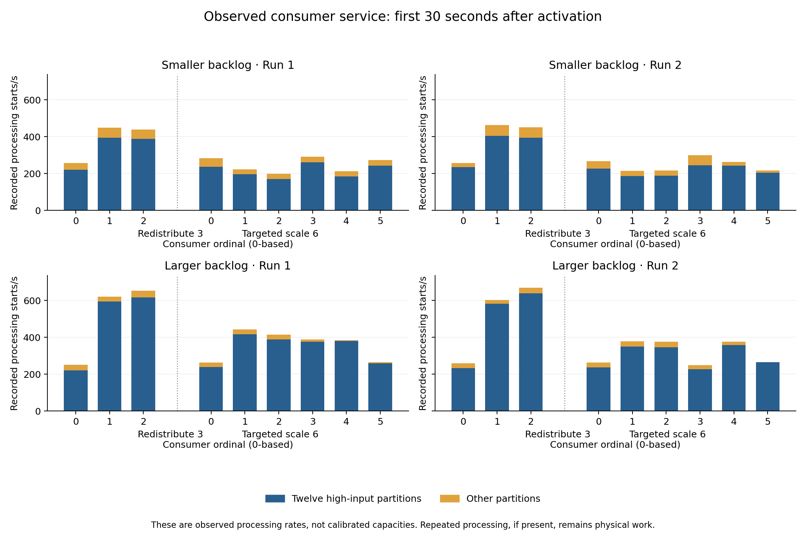

# Processing after mitigation

This analysis follows individual messages and partition service after mitigation in the sixteen existing [starting-backlog trials](../backlog-comparison-20261027/README.md). The main comparison is redistribution within three consumers versus scaling to six with targeted redistribution. Keep 3 and normal Kafka scaling provide context. It extends the [pre-action service analysis](../consumer-scheduling-20261029/README.md) without running new experiments or changing consumer scheduling.

The results separate three questions: when the messages already waiting finish, how the confirmed assignment processes its remaining work, and when the pipeline reaches the predefined recovery criterion while new input continues. These events do not occur at the same time.

## Main findings

Targeted scaling had higher throughput in the first 30 seconds after activation and earlier confirmed pipeline recovery than redistribution in all four comparisons. However, activation took longer, and its previously reported whole-evaluation completion p99 was higher in all four comparisons. The faster processing after activation does not erase delay experienced earlier. These observations describe the tested responses and their different activation times; they do not isolate consumer count from assignment, preparation cost or machine differences.

| Starting backlog | Run | Response | Activation delay (s) | Waiting at activation (messages) | First 30 s throughput (msg/s) | Recovery from decision (s) |
| --- | --- | --- | ---: | ---: | ---: | ---: |
| Smaller | 1 | Redistribute 3 | 37.5 | 24,357 | 1144.7 | 236.0 |
| Smaller | 1 | Targeted scale 6 | 92.4 | 27,184 | 1480.2 | 158.0 |
| Smaller | 2 | Redistribute 3 | 40.2 | 25,492 | 1170.6 | 242.0 |
| Smaller | 2 | Targeted scale 6 | 102.7 | 32,289 | 1475.3 | 190.0 |
| Larger | 1 | Redistribute 3 | 37.6 | 50,361 | 1525.4 | 420.0 |
| Larger | 1 | Targeted scale 6 | 143.9 | 71,193 | 2157.4 | 260.0 |
| Larger | 2 | Redistribute 3 | 38.1 | 54,478 | 1532.0 | 432.0 |
| Larger | 2 | Targeted scale 6 | 95.3 | 61,692 | 1907.9 | 234.0 |

Activation delay is measured from the scheduled decision at evaluation second 60. The throughput window begins at confirmation of the resulting assignment. The windows therefore occur at different times, with different amounts and ages of waiting work. Recovery is measured from the common scheduled decision and requires processing backlog at most 100 offsets for 30 consecutive valid seconds during input. Waiting-message counts reconcile acknowledgments and completions; they are not interchangeable with sampled offset backlog.

In both smaller-backlog targeted-scaling runs, every message waiting at the scheduled decision finished before transfer was requested. In Run 1, that group contained 14,465 messages and finished 56.7 seconds after the decision. Transfer was requested at 62.8 seconds and the assignment was confirmed at 92.4 seconds. By confirmation, 27,184 newer messages were waiting. In Run 2, the decision-time group finished at 55.7 seconds, before transfer was requested at 74.7 seconds; confirmation followed at 102.7 seconds. Thus, evaluating only the initial waiting group would miss the newer backlog affected by these actions.

Keep 3 also finished every decision-time waiting message in all four trials, despite failing to reach the pipeline recovery criterion and leaving later evaluation messages unfinished at the cutoff. Clearing a finite initial group is therefore insufficient evidence that the pipeline can keep up with continuing input.



The diamonds mark completion of the whole group waiting at the scheduled decision; squares mark confirmed pipeline recovery. Open arrows mean recovery was unconfirmed by evaluation end, 540 seconds after the decision. The blue Keep 3 marker is only a reference boundary, since no assignment change occurs. The gray line extends to assignment confirmation and must not be read as a global processing pause. Original consumers can continue working while new consumers are prepared, and processing may resume before confirmation.

## Which work receives service after activation?



Each bar counts distinct messages whose first completion falls within the first 30 seconds after confirmation, divided by 30 seconds. The dark blue part belongs to the decision-time waiting group. Light blue represents other messages waiting at activation, and amber represents messages created after activation. The small gray remainder includes earlier-created messages whose producer acknowledgment was recorded after activation. Warm-up messages remain included if they complete in this interval. No repeated completions were found in these sixteen trials.

The smaller-backlog targeted-scaling bars have no dark blue component because that initial group had already finished. Their substantial blue component instead represents work that accumulated later. In the larger-backlog comparisons, both initial waiting messages and later messages still receive service after activation. This composition must be considered when interpreting a high throughput value or comparing remaining work at a fixed horizon.



The consumer plot separates processing starts for the twelve high-input partitions from the other partitions. It retains physical processing work and uses the same activation-aligned 30-second interval. It does not estimate maximum capacity. In the larger-backlog redistribution runs, Consumer 0 recorded approximately 251–259 starts/s while Consumers 1 and 2 recorded approximately 603–670 starts/s. A single common service rate would conceal these observed differences, but available work, fetch availability and processing conditions must be checked before using these values as capacity estimates.

Across the 72 consumer windows, 545,379 processing starts were recorded. There were 2,235 creation-time backtracks over 100 ms among 144,884 cross-partition comparisons within the same producer's subsequence. Offsets increased within each topic-partition and assignment epoch, and no overlapping or reversed processing timestamps were found in the selected windows. These checks describe the recorded application order. They cannot determine which other partition records were already in the local client buffer when each message was selected.

## Boundaries and interpretation

The decision-time group contains messages created before the scheduled decision, acknowledged by it, and not completed then. The activation-time group contains acknowledged messages still unfinished when the resulting assignment is confirmed. Each group is followed to the original drain cutoff. Its clearance time is the last earliest completion; it remains unavailable if any member is unfinished. Fractional clearance times use the entire group as their denominator rather than only completed members. Group completion latency runs from message creation to completion and is reported alongside unfinished and deadline outcomes in the machine-readable results.

Completion windows use a left-inclusive, right-exclusive interval. Pending counts at an endpoint include acknowledgments recorded by that endpoint and exclude completions recorded by it. The existing whole-run and decision-cohort calculations include a completion exactly at the drain cutoff. Before, Active–end and Eval. end retain the established reporting boundaries; this analysis adds Decision–activation and First 30 s active. These are reporting intervals, not new controller signals.

The data support checking predictions at both a common decision horizon and after actual activation. A prediction based only on the original backlog would miss new arrivals, preparation time, the age of waiting messages, and differences in observed consumer service. Conversely, selecting the fastest observed activation-aligned rate would ignore when it becomes available. This analysis identifies the quantities that a candidate model must account for; it does not establish a new scheduling rule or validate a controller.

The smaller and larger conditions also differ in the age and warm-up history of queued messages, so their difference is not a pure backlog-size treatment. Two runs per response, shared infrastructure and cross-node clock uncertainty limit inference. Batch boundaries, fetch-return times and local-buffer availability were not logged. Post-action observations can evaluate a prediction retrospectively, but cannot be used as information that was already available at the decision. Many waiting messages had already exceeded the one-second deadline at that point; a later action can reduce further delay but cannot undo an elapsed deadline.

## Reproduction and validation

From the repository root, with the separately retained raw logs present:

```bash
python3 -m unittest discover -s experiments/decision-rule-audit -p 'test_post_mitigation.py' -v
python3 experiments/decision-rule-audit/analyze_post_mitigation.py --repo . --output /tmp/post-mitigation
python3 experiments/decision-rule-audit/plot_post_mitigation.py --results /tmp/post-mitigation/results.json
```

The analyzer uses the standard library and the existing scheduling-analysis helpers. Only the figures require Matplotlib. It checks compressed and decompressed log hashes, final writer status, message identity, assignment confirmation, and reconciliation with the original cohort counts and p99 values. All sixteen trials passed. All fifteen monitoring samples in each first-active window were valid and matched the confirmed owner map. An independent reread of smaller-backlog targeted-scaling Run 1 reproduced the decision-group count, transfer timing, activation-group count and 44,405 first-window completions.

Nine unit checks cover decision boundaries, disjoint groups, clearance with unfinished messages, changed cohorts before activation, deadline censoring, cutoff inclusion, empty groups, and missing or changed ownership. [Validation details](validation.json) and the [independent check](independent-check.json) are retained with [source hashes](source-manifest.json).

[Summary](summary.csv), [per-partition service](partition-service.csv), [per-consumer service](consumer-service.csv), and [full numerical results](results.json) preserve individual trial values. Large raw logs remain outside Git. This report adds no performance trials and leaves the existing proposal results unchanged.
