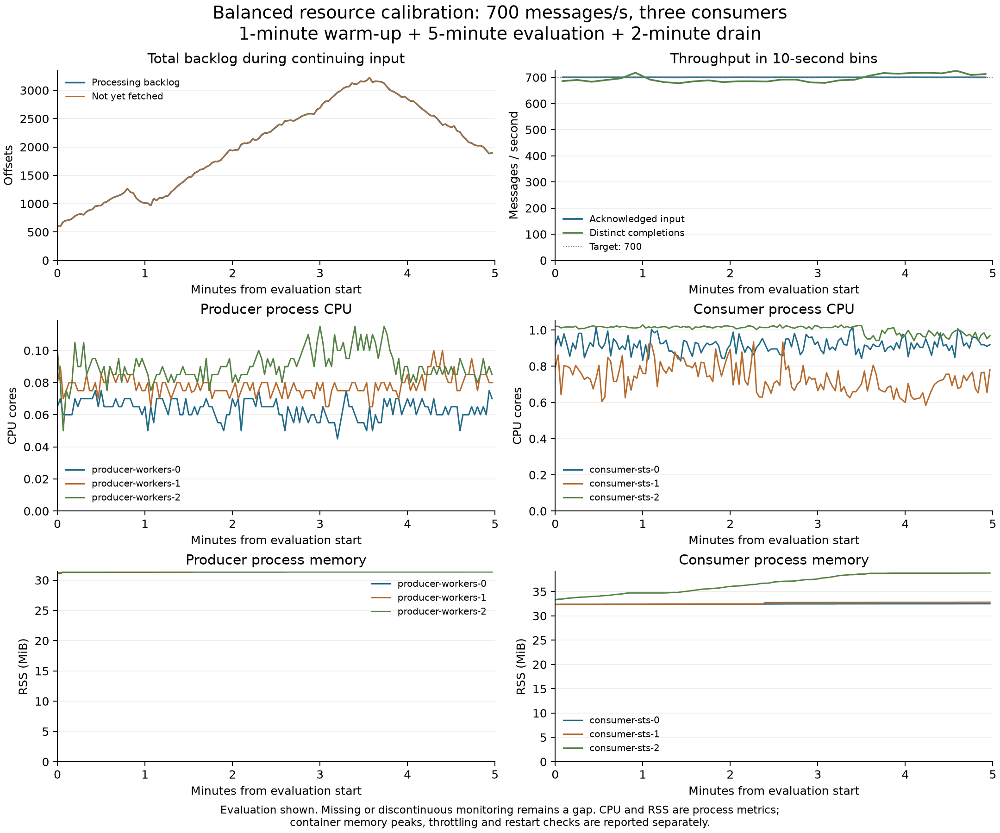

# Client resource calibration and producer recovery

The October 20 deployment calibration tested smaller client allocations and a replacement producer deployment on Nautilus. It is a separate technical calibration and is **not included in the 24 main-proposal trials**. The September measurements and their resource-cost calculations are unchanged.

## Calibration result

Run `run-20261020-225743` used balanced input at **700 aggregate messages/s**, three producers, three fixed consumers, 60 partitions and 2,000 SHA-256 iterations per message. There was no scaling or reassignment. Timing was one minute warm-up, five minutes evaluation and two minutes drain: eight minutes total. The run used source revision `8f6b34e02af5493d407e6131aa5ca7c34d83571e`, a fresh topic, seed 71 and distinct logical producer IDs 0, 1 and 2.

| Measurement | Result |
|---|---:|
| Acknowledged evaluation messages | 210,000 |
| Achieved evaluation input | 700.00 messages/s |
| Distinct completions during evaluation | 696.05 messages/s |
| Evaluation messages completed by drain cutoff | 210,000 |
| Unfinished at drain cutoff | 0 (0%) |
| Completion latency: minimum / mean / maximum | 0.026 / 2.932 / 13.601 s |
| Completion p99 | 13.217 s |
| One-second completion-target violations | 33.27% |
| Peak observed processing backlog | 3,225 offsets |
| Processing backlog at last valid evaluation observation | 1,897 offsets |
| Evaluation lag coverage | 99.33% |

Latency uses one completion per acknowledged evaluation message, through the drain cutoff; completion is before commit acknowledgment. Throughput counts distinct completions during evaluation, including warm-up messages that finish then. It is not the count completed through drain divided by evaluation time. No delivery failures, unresolved sends, duplicate completion attempts, invalid clock observations or within-ownership ordering violations were recorded. The run and measurement checks passed.

[PDF plot](calibration-overview.pdf) · [Machine-readable summary](calibration-summary.json) · [Configuration](calibration-config.yaml)

Backlog increased from about 608 offsets to a peak of 3,225, then decreased to 1,897 while production continued. The dominant backlog was associated with consumer 2, which averaged approximately one CPU core during evaluation. Clearing the remaining work during drain does not establish stability under continuous input. This short observation shows that the revised deployment can deliver the requested rate and preserve complete evidence, but does not establish a sustained low-backlog operating point. A longer balanced calibration is needed before accepting the revised conditions for comparative trials; the full trace and per-consumer rates should guide whether the target rate needs adjustment.

## Resource allocations and observations

| Container | Previous CPU request / limit | Revised CPU request / limit | Previous RAM request / limit | Revised RAM request / limit |
|---|---:|---:|---:|---:|
| Producer | 2 / 4 cores | 0.25 / 0.30 cores | 1 / 2 GiB | 128 / 152 MiB |
| Consumer | 2 / 4 cores | 1 / 1.2 cores | 1 / 2 GiB | 512 / 600 MiB |
| Bootstrap init, each role | 0.1 / 0.1 cores | 0.1 / 0.12 cores | 1 / 1 GiB, inherited | 128 / 152 MiB |

Explicit init-container memory requests avoid the namespace's inherited 1 GiB request. Broker allocations and JVM settings were unchanged.

Across the three producers, mean process CPU during observed evaluation intervals was approximately 0.06–0.09 cores. Consumer means were 0.92, 0.73 and 1.00 cores for consumers 0, 1 and 2. Container memory peaks captured since startup were 47.7–71.8 MiB for producers and 76.7–103.0 MiB for consumers, below their 152 and 600 MiB limits. All clients had zero container restarts and zero recorded out-of-memory events. Near-evaluation cgroup counter intervals recorded at most 0.182 seconds of cumulative throttling per producer and 0.027 seconds per consumer. These counters include diagnostic work and use separately recorded boundaries; they are not exact application-only evaluation measurements.

Process RSS and container memory are different measures. The plots show process RSS; container peaks also include memory charged outside that process. Neither the short run nor historical sampled peaks guarantees future memory bounds. The busiest consumer remained near one core despite little quota throttling, so the evidence does not establish that raising its CPU limit alone would solve the backlog. Historical consumer RSS reached approximately 275.7 MiB in the skew trials; the short balanced result is not a basis for lowering consumer memory further. [Historical sizing evidence](sizing-evidence.json) identifies those observations and source hashes.

## Deployment and retained evidence

The active producer StatefulSet is `producer-workers`. All six calibration clients ran on separate nodes under required producer–consumer anti-affinity. Other workloads may share those machines; identical processing capacity is not guaranteed. Source hashes, distinct workload IDs, partition readiness and monitoring were checked before traffic. Prometheus scraped active clients every two seconds. Initial ownership remained unchanged during production. Read-only kernel clock diagnostics reported synchronized status before and after the run; those diagnostics are not an independent bound on cross-node clock error.

The replacement uses new producer and configuration claims, `producer-data-20261020` and `pipeline-config-20261020`. Consumers share the new configuration claim. The retired `producer-sts-1` remains Terminating on an unreachable node and was not force-deleted. All 17 original PVC identities and backing volumes were preserved; the two new claims bring the total to 19. Replacement clients were scaled to zero after collection and terminated normally. Brokers, Prometheus and Grafana remain available. Temporary source-copy resources were removed.

The earlier utilization-admission rejection and storage inspections are retained in the linked verification records. Later server dry runs and deployment succeeded. No PVC deletion was used to resolve the old pod's node-reachability problem.

- [Deployment and test verification](replacement-verification.json): 370 automated tests, accepted dry runs, actual nodes, image digests and allocations.
- [Original template verification](deployment-check.json) and [storage inspection](storage-check.json).
- [Original producer/config backup](backup-check.json): 544 regular files, 6,962,049,143 uncompressed bytes, with every archived file verified. This is a file-copy backup, not an atomic storage snapshot.
- [Calibration backup](calibration-backup-check.json): all 33 local run files, including raw message evidence, monitoring exports, configurations and analyses, verified against a separate compressed archive. The archive contains 450,495,057 uncompressed bytes and is kept outside Git.

A complete repository mirror passed Git integrity checks and contained every pre-migration local ref. Existing consumer source was separately backed up before replacement. Small summaries and evidence hashes are versioned here; they do not replace the raw backups. The proposal's 24-trial tables remain associated with their original workload generator, resources and placement.
