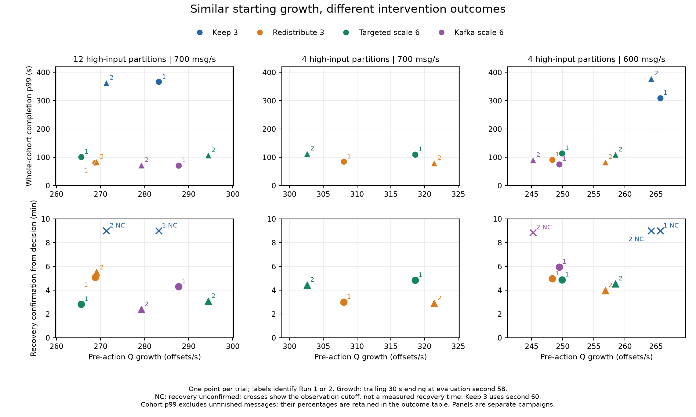
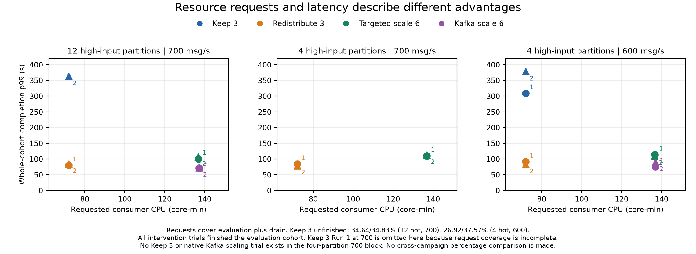
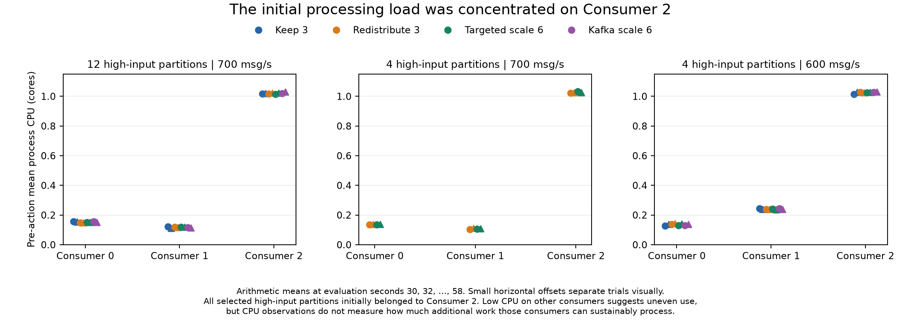

# Signals before action and experimental outcomes

The twenty trials cover three separate experiment blocks. Eight twelve-partition trials at 700 messages/s provide the primary comparison; four four-partition trials at 700 and eight at 600 provide additional evidence. All actions were scheduled; these records do not demonstrate a learned or adaptive controller.

Redistribution confirmed the specified backlog-recovery criterion and completed every evaluation message in all six observed trials. This establishes observed sufficiency for those two criteria in the tested conditions, not for an unspecified application SLO. Its absence of observed failures prevents learning a redistribution success/failure boundary from these trials alone.

The twelve-partition block shows a trade-off: redistribution used 72 requested CPU core-minutes and had p99 of 80.10/84.16 s; Kafka scaling used about 137 core-minutes and had p99 of 71.41/72.46 s. Targeted scaling recovered sooner than redistribution in both repetitions, despite higher whole-cohort p99. Recovery and latency rank the responses differently.

The four-partition 700 block favors redistribution over targeted scaling on recorded p99, recovery time and requested resources in both repetitions. Keep 3 and native scaling were not tested in that block. The 600 block includes all four actions; Kafka scaling had the lowest p99 in Run 1 and redistribution in Run 2. Kafka scaling Run 2 completed during drain without confirming low-backlog recovery during input.

Starting ownership concentration is constant in all twenty trials, and persistent-hot count is constant within each block. Skew values mostly distinguish the four- and twelve-partition designs. A pooled correlation could therefore reflect the experimental design or changed deployment rather than a transferable decision rule.

The present records support descriptive comparisons and hypotheses. They do not support a defensible general-purpose classifier or neural controller. No predictive model, feature-importance ranking, significance test or pooled correlation is fitted in this analysis.

## Starting conditions

12 high-input partitions | 700 msg/s: pre-action mean backlog 27,888.0-29,522.9 offsets; 30-second processing-backlog growth 265.6-294.4 offsets/s; mean skew 4.9-5.0. All high-input partitions belonged to Consumer 2.

4 high-input partitions | 700 msg/s: pre-action mean backlog 31,136.5-31,738.9 offsets; 30-second processing-backlog growth 302.6-321.4 offsets/s; mean skew 14.0-14.2. All high-input partitions belonged to Consumer 2.

4 high-input partitions | 600 msg/s: pre-action mean backlog 21,244.3-26,486.9 offsets; 30-second processing-backlog growth 245.2-265.7 offsets/s; mean skew 14.1-14.4. All high-input partitions belonged to Consumer 2.

## Pre-action measurements

| Block | Response | Run | Mean B (offsets) | Q growth (offsets/s) | Mean skew | Persistent hot | CPU (cores) | RSS (MiB) |
| --- | --- | --- | --- | --- | --- | --- | --- | --- |
| 12hot-700 | Keep 3 | 1 | 27,888 | 283.2 | 4.92 | 12 | 1.295 | 148.5 |
| 12hot-700 | Keep 3 | 2 | 28,233 | 271.3 | 4.95 | 12 | 1.285 | 149.1 |
| 12hot-700 | Redistribute 3 | 1 | 28,023 | 268.8 | 4.91 | 12 | 1.285 | 150.4 |
| 12hot-700 | Redistribute 3 | 2 | 29,396 | 269.1 | 4.94 | 12 | 1.286 | 151.0 |
| 12hot-700 | Targeted 6 | 1 | 28,168 | 265.6 | 4.93 | 12 | 1.282 | 149.9 |
| 12hot-700 | Targeted 6 | 2 | 29,523 | 294.4 | 4.94 | 12 | 1.291 | 151.8 |
| 12hot-700 | Kafka 6 | 1 | 28,167 | 287.7 | 4.93 | 12 | 1.290 | 148.8 |
| 12hot-700 | Kafka 6 | 2 | 29,172 | 279.3 | 4.95 | 12 | 1.295 | 150.4 |
| 4hot-700 | Redistribute 3 | 1 | 31,136 | 308.0 | 14.22 | 4 | 1.261 | 149.9 |
| 4hot-700 | Redistribute 3 | 2 | 31,739 | 321.4 | 14.06 | 4 | 1.274 | 151.1 |
| 4hot-700 | Targeted 6 | 1 | 31,302 | 318.6 | 14.20 | 4 | 1.272 | 149.3 |
| 4hot-700 | Targeted 6 | 2 | 31,503 | 302.6 | 14.04 | 4 | 1.271 | 152.4 |
| 4hot-600 | Keep 3 | 1 | 25,912 | 265.7 | 14.10 | 4 | 1.385 | 143.2 |
| 4hot-600 | Keep 3 | 2 | 26,218 | 264.2 | 14.33 | 4 | 1.403 | 143.5 |
| 4hot-600 | Redistribute 3 | 1 | 21,244 | 248.3 | 14.25 | 4 | 1.404 | 134.7 |
| 4hot-600 | Redistribute 3 | 2 | 25,791 | 256.8 | 14.33 | 4 | 1.407 | 142.6 |
| 4hot-600 | Targeted 6 | 1 | 26,487 | 249.9 | 14.15 | 4 | 1.396 | 143.9 |
| 4hot-600 | Targeted 6 | 2 | 26,245 | 258.5 | 14.34 | 4 | 1.404 | 143.9 |
| 4hot-600 | Kafka 6 | 1 | 26,176 | 249.4 | 14.15 | 4 | 1.399 | 142.3 |
| 4hot-600 | Kafka 6 | 2 | 25,348 | 245.2 | 14.36 | 4 | 1.405 | 141.7 |

## Outcomes

| Block | Response | Run | p99 (s) | Unfinished (%) | 1 s misses (%) | Recovery (min) | Throughput (msg/s) | CPU requests (core-min) |
| --- | --- | --- | --- | --- | --- | --- | --- | --- |
| 12hot-700 | Keep 3 | 1 | 366.64 | 34.64 | 83.32 | Unconfirmed | 423.2 | Unavailable |
| 12hot-700 | Keep 3 | 2 | 362.79 | 34.83 | 83.36 | Unconfirmed | 422.6 | 72.0 |
| 12hot-700 | Redistribute 3 | 1 | 80.10 | 0.00 | 30.50 | 5.09 | 727.7 | 72.0 |
| 12hot-700 | Redistribute 3 | 2 | 84.16 | 0.00 | 31.84 | 5.48 | 729.5 | 72.0 |
| 12hot-700 | Targeted 6 | 1 | 100.81 | 0.00 | 26.26 | 2.82 | 727.8 | 136.9 |
| 12hot-700 | Targeted 6 | 2 | 107.24 | 0.00 | 27.33 | 3.08 | 729.3 | 136.8 |
| 12hot-700 | Kafka 6 | 1 | 71.41 | 0.00 | 25.83 | 4.32 | 727.6 | 137.2 |
| 12hot-700 | Kafka 6 | 2 | 72.46 | 0.00 | 21.05 | 2.38 | 728.5 | 137.1 |
| 4hot-700 | Redistribute 3 | 1 | 84.50 | 0.00 | 26.63 | 3.01 | 730.9 | 72.0 |
| 4hot-700 | Redistribute 3 | 2 | 79.28 | 0.00 | 25.82 | 2.89 | 731.4 | 72.0 |
| 4hot-700 | Targeted 6 | 1 | 110.19 | 0.00 | 35.23 | 4.84 | 730.9 | 136.8 |
| 4hot-700 | Targeted 6 | 2 | 112.94 | 0.00 | 34.72 | 4.45 | 731.1 | 136.8 |
| 4hot-600 | Keep 3 | 1 | 309.29 | 26.92 | 85.66 | Unconfirmed | 392.2 | 72.0 |
| 4hot-600 | Keep 3 | 2 | 378.35 | 37.57 | 85.70 | Unconfirmed | 347.1 | 72.0 |
| 4hot-600 | Redistribute 3 | 1 | 91.82 | 0.00 | 38.76 | 4.99 | 617.6 | 72.0 |
| 4hot-600 | Redistribute 3 | 2 | 83.29 | 0.00 | 31.32 | 3.98 | 625.2 | 72.0 |
| 4hot-600 | Targeted 6 | 1 | 114.08 | 0.00 | 36.75 | 4.88 | 625.9 | 136.7 |
| 4hot-600 | Targeted 6 | 2 | 109.42 | 0.00 | 33.43 | 4.55 | 625.5 | 136.5 |
| 4hot-600 | Kafka 6 | 1 | 75.59 | 0.00 | 44.35 | 5.96 | 625.7 | 137.0 |
| 4hot-600 | Kafka 6 | 2 | 90.28 | 0.00 | 66.75 | Unconfirmed | 597.4 | 136.9 |

## Definitions and interpretation

- **unit:** One performance trial; scheduled intervention at evaluation second 60.
- **pre_action_means:** 15 valid, contiguous observations at nominal seconds 30,32,...,58; equal weight. Missing or discontinuous grids remain unavailable.
- **growth:** Last pre-action trailing 30-second growth, (Q58-Q28)/(t58-t28), using 16 valid contiguous snapshots. B growth is also retained. This differs from a mean of the historical 10-second plotted growth series.
- **persistence:** At second 58: hot now and hot in at least 80% of the last 15 observations; lag > 10 and lag > partition mean + one population standard deviation.
- **resources:** CPU in process cores; RSS in MiB. Requires fresh per-incarnation observations for all original consumers at all 15 sample points. No imputation.
- **full_evaluation_means:** Equal-weight means of valid raw evaluation observations, reused from the reviewed summaries; not a time-weighted mean or a mean of rolling means.
- **recovery:** Total processing backlog <= 100 offsets for 30 continuous valid seconds during input. Gaps/ownership changes restart the hold. Keep 3 uses second 60 as reference. Unconfirmed is censored, not zero or necessarily persistent failure.
- **outcomes:** Completion before commit acknowledgment; cohort p99 and unfinished followed through fixed drain. Completion-window statistics use different populations and exclude drain.
- **useful_throughput:** Distinct messages completed during the 600-second evaluation divided by 600 seconds; includes warm-up messages finishing in that interval. It is not completed evaluation-cohort messages divided by the observation period.
- **cost:** Requested consumer resources integrated over evaluation plus drain, retained only with full request-history coverage. Not actual usage or whole-cluster cost.
- **interpretation:** Descriptive associations; no fitted predictive model, causal feature attribution, pooled rate comparison or application-sufficiency label.

The CSV is one row per trial; blank fields are unavailable, not zero. JSON retains per-owner resources, coverage, pre-action and later completion windows, source hashes, and grouping metadata. Pending/unfinished messages must accompany completed-message percentiles. Small latency differences remain subject to original clock uncertainty.

## Next experiments

First vary initial ownership at fixed workload and deployment: concentrated on one consumer, partly distributed, and already distributed. Compare the available actions in matched blocks with reversed or randomized action order. This directly tests whether ownership improves prediction beyond backlog and skew.

Then vary offered work relative to measured consumer capacity while keeping the ownership design controlled. Measure per-consumer service capacity under sustained available work; do not infer capacity from an underloaded completion rate or CPU percentage. Select load levels on both sides of the observed recovery boundary using calibration.

Retain unfavorable outcomes and unconfirmed recoveries. Keep trial/campaign/seed groups together in future validation; neighboring scrapes and windows are not independent examples. Reserve separate workload schedules for final testing and record deployment changes.

Specify acceptable deadline-miss, unfinished-work and recovery requirements before assigning an application-sufficiency label. Start with a simple interpretable baseline only when the experiments include diverse conditions and both sufficient and insufficient redistribution outcomes.







## Reproduce

From the repository root, with the retained raw evidence available:

```bash
python3 experiments/signal-outcome-20261021/build_analysis.py --output /path/to/analysis
python3 experiments/signal-outcome-20261021/build_report.py /path/to/analysis/analysis.json --output /path/to/analysis
```

The analysis requires no cluster access. The report builder uses Matplotlib and ReportLab. The input hashes in `analysis.json` identify the exact evidence and summaries used.

## Partition rates and capacity

The [capacity diagnostic](CAPACITY_CHECK.md) uses saved producer counters and fifteen existing calibration records to examine the offered load of each assignment. The original hot owner sustained about 292 messages/s in selected backlogged intervals; historical redistribution reduced its estimated assigned input from about 580–603 to 182–233 messages/s. Capacity remains unmeasured for some consumers and conditions. The separate [assignment CSV](assignment-capacity.csv) retains all twenty trial checks; [capacity-analysis.json](capacity-analysis.json) records the method, windows, conditions and source hashes. This adds no performance trials and changes no recorded outcomes.
