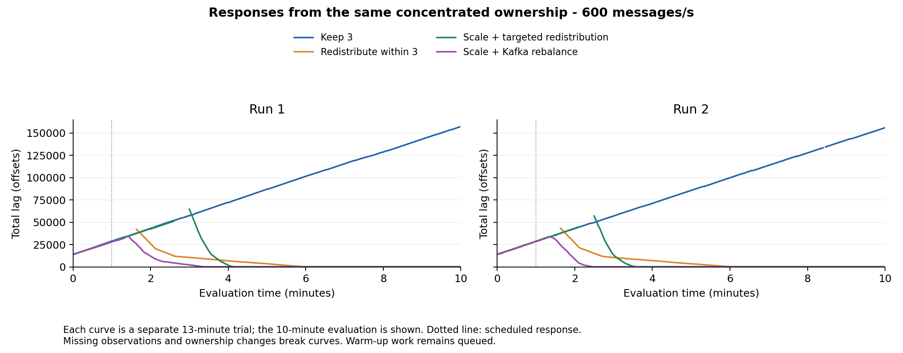

# Twelve-partition comparison at 600 messages/s with Consumer 0

All eight performance trials completed and passed validation. Twelve of 60 partitions received 80% of the 600 messages/s total input and initially belonged to Consumer 0. Each response was tested twice, with seeds 81 and 82 and reversed response order in the second repetition. Each trial used 60 seconds of warm-up, 600 seconds of evaluation and 120 seconds of drain. Actions were requested at evaluation second 60.

The first Keep 3 trial passed the prespecified sustained-growth gate. The unchanged assignment left roughly 34–35% of evaluation messages unfinished at the drain cutoff. All three interventions completed the evaluation cohort and met the low-backlog recovery criterion while input continued. Kafka scaling achieved the lowest p99 and earliest recovery in both repetitions. Targeted scaling recovered sooner than redistribution within three consumers, but had higher p99. Redistribution used the existing three consumers and lower requested-resource totals. These conclusions apply to this deployment and the two repetitions.

| Response | Run | p99 end-to-end latency (s) | Unfinished (%) | Recovery confirmed after decision (s) | Requested CPU (core-min) |
|---|---:|---:|---:|---:|---:|
| Keep 3 | 1 | 368.54 | 35.11 | No intervention | 72.00 |
| Keep 3 | 2 | 363.70 | 34.44 | No intervention | 72.00 |
| Redistribute within 3 | 1 | 83.28 | 0.00 | 318.3 | 72.00 |
| Redistribute within 3 | 2 | 84.71 | 0.00 | 322.5 | 72.00 |
| Scale to 6 with targeted redistribution | 1 | 121.43 | 0.00 | 210.8 | 133.32 |
| Scale to 6 with targeted redistribution | 2 | 109.31 | 0.00 | 174.4 | 136.54 |
| Scale to 6 with Kafka rebalancing | 1 | 67.81 | 0.00 | 163.0 | 136.91 |
| Scale to 6 with Kafka rebalancing | 2 | 68.64 | 0.00 | 108.8 | 136.96 |

P99 uses evaluation messages completed by the drain cutoff. Unfinished percentages use all 360,000 acknowledged evaluation messages per trial. Recovery requires total processing backlog at most 100 offsets for 30 consecutive valid seconds during continuing input. Requested resources cover evaluation and drain. Actual CPU/RSS records are retained separately.

Initial producer and consumer placement and settings matched the successful Consumer 0 control. The initial hot partitions were 0, 3, 6, 9, 12, 15, 18, 21, 24, 27, 30 and 33. Added-consumer placement was recorded. Kafka scaling used cooperative rebalancing and the targeted responses used coordinated explicit ownership. Their activation and processing-pause boundaries differ. Valid lag coverage ranged from 95.7% to 99.7%, with missing intervals preserved as gaps.

Execution revision: `4d4a24f8a0c6051b9df125505817b9551bcafdc7`. The batch restored the original configuration and three-consumer baseline. Two empty-topic preparations and one native-scaling technical trial are separate from the eight performance trials. Earlier control `run-20261104-073554` also remains separate. Raw evidence has a verified second local copy outside Git. Git records contain summaries and evidence hashes, not the raw-data backup.

[Summary, run IDs, evidence hashes and descriptive repeat means](summary.json) · [Admission plan](admission-plan.json) · [Prior monitoring gate](monitoring-gate.json)

